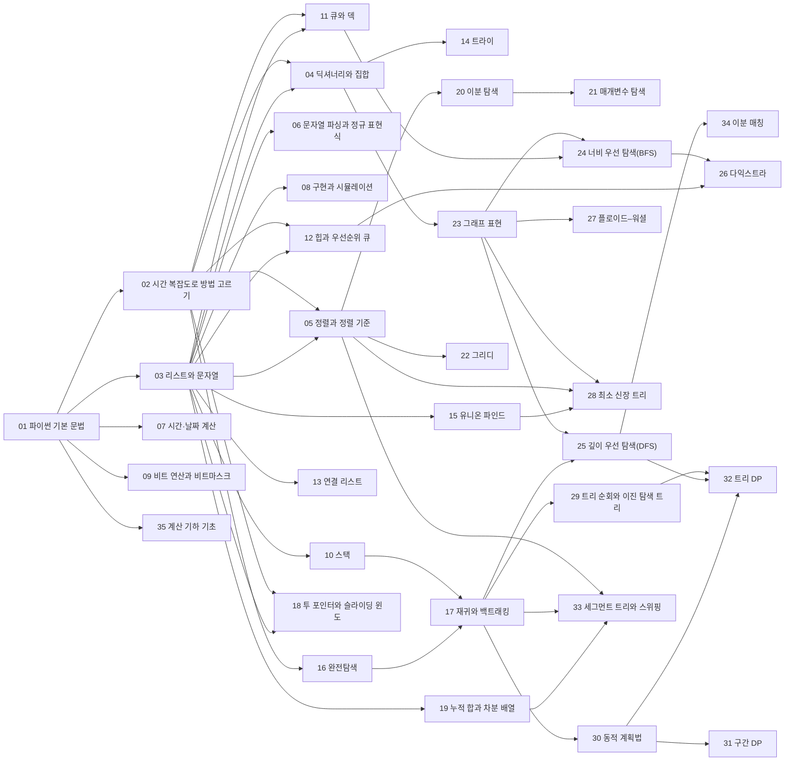

# 알고리즘 로드맵

## 1단원 · 파이썬으로 문제 풀기
> [!question]- 읽기 전에
> 1. `7 // 2`, `7 % 2`, `-7 // 2`의 값은 각각 무엇일까? → [[알고리즘/3.개념집/01.파이썬 기본 문법|파이썬 기본 문법]]
> 2. 입력이 10만 개일 때, 모든 쌍을 비교하는 방법은 1초 안에 끝날까? → [[알고리즘/3.개념집/02.시간 복잡도로 방법 고르기|시간 복잡도로 방법 고르기]]
> 3. 이름 10만 개 중에서 한 이름이 있는지 확인하는 가장 빠른 방법은? → [[알고리즘/3.개념집/04.딕셔너리와 집합|딕셔너리와 집합]]

| 번호 | 개념 | 한 줄 | 개념 코드 | 연습 |
|---|---|---|---|---|
| 01 | [[알고리즘/3.개념집/01.파이썬 기본 문법\|파이썬 기본 문법]] | 값과 변수, 조건문, 반복문, 함수. solution 함수 하나가 답안이다 | [[알고리즘/3.개념집/01_python-basics_verify.py\|verify]] | [[알고리즘/4.연습문제/01.짝수와 홀수\|짝수와 홀수]] ([[알고리즘/4.연습문제/01_pg12937_p1.py\|코드]]) |
| 02 | [[알고리즘/3.개념집/02.시간 복잡도로 방법 고르기\|시간 복잡도로 방법 고르기]] | 제한의 크기를 보고 연산 횟수를 어림해, 쓸 수 있는 방법을 미리 고른다 (무거움) | [[알고리즘/3.개념집/02_complexity-budget_bench.py\|bench]] · [[알고리즘/3.개념집/02_complexity-budget_fig1.svg\|fig1]] · [[알고리즘/3.개념집/02_complexity-budget_fig2.svg\|fig2]] · [[알고리즘/3.개념집/02_complexity-budget_plot.py\|plot]] · [[알고리즘/3.개념집/02_complexity-budget_verify.py\|verify]] | [[알고리즘/4.연습문제/02.시간 복잡도 어림 예제 사다리\|시간 복잡도 어림 예제 사다리]] |
| 03 | [[알고리즘/3.개념집/03.리스트와 문자열\|리스트와 문자열]] | 번호로 꺼내는 줄. 인덱스, 슬라이싱, 메서드, 컴프리헨션 | [[알고리즘/3.개념집/03_list-string_verify.py\|verify]] | [[알고리즘/4.연습문제/03.평균 구하기\|평균 구하기]] ([[알고리즘/4.연습문제/03_pg12944_p1.py\|코드]]), [[알고리즘/4.연습문제/03.숫자 문자열과 영단어\|숫자 문자열과 영단어]] ([[알고리즘/4.연습문제/03_pg81301_p1.py\|코드]]), [[알고리즘/4.연습문제/03.k진수에서 소수 개수 구하기\|k진수에서 소수 개수 구하기]] ([[알고리즘/4.연습문제/03_pg92335_p1.py\|코드]]), [[알고리즘/4.연습문제/03.n진수 게임\|n진수 게임]] ([[알고리즘/4.연습문제/03_pg17687_p1.py\|코드]]) |
| 04 | [[알고리즘/3.개념집/04.딕셔너리와 집합\|딕셔너리와 집합]] | 이름표로 바로 찾는 표(해시). 넣기·찾기가 평균 O(1) (무거움) | [[알고리즘/3.개념집/04_hash-dict-set_fig1.svg\|fig1]] · [[알고리즘/3.개념집/04_hash-dict-set_impl.py\|impl]] · [[알고리즘/3.개념집/04_hash-dict-set_plot.py\|plot]] | [[알고리즘/4.연습문제/04.완주하지 못한 선수\|완주하지 못한 선수]] ([[알고리즘/4.연습문제/04_pg42576_p1.py\|코드]]), [[알고리즘/4.연습문제/04.성격 유형 검사하기\|성격 유형 검사하기]] ([[알고리즘/4.연습문제/04_pg118666_p1.py\|코드]]), [[알고리즘/4.연습문제/04.신고 결과 받기\|신고 결과 받기]] ([[알고리즘/4.연습문제/04_pg92334_p1.py\|코드]]), [[알고리즘/4.연습문제/04.가장 많이 받은 선물\|가장 많이 받은 선물]] ([[알고리즘/4.연습문제/04_pg258712_p1.py\|코드]]), [[알고리즘/4.연습문제/04.뉴스 클러스터링\|뉴스 클러스터링]] ([[알고리즘/4.연습문제/04_pg17677_p1.py\|코드]]), [[알고리즘/4.연습문제/04.압축\|압축]] ([[알고리즘/4.연습문제/04_pg17684_p1.py\|코드]]), [[알고리즘/4.연습문제/04.오픈채팅방\|오픈채팅방]] ([[알고리즘/4.연습문제/04_pg42888_p1.py\|코드]]) |
| 05 | [[알고리즘/3.개념집/05.정렬과 정렬 기준\|정렬과 정렬 기준]] | sorted와 key로 원하는 순서 만들기. 같은 값은 원래 순서를 지킨다 | [[알고리즘/3.개념집/05_sorting_fig1.svg\|fig1]] · [[알고리즘/3.개념집/05_sorting_impl.py\|impl]] · [[알고리즘/3.개념집/05_sorting_plot.py\|plot]] | [[알고리즘/4.연습문제/05.K번째수\|K번째수]] ([[알고리즘/4.연습문제/05_pg42748_p1.py\|코드]]), [[알고리즘/4.연습문제/05.실패율\|실패율]] ([[알고리즘/4.연습문제/05_pg42889_p1.py\|코드]]), [[알고리즘/4.연습문제/05.무지의 먹방 라이브\|무지의 먹방 라이브]] ([[알고리즘/4.연습문제/05_pg42891_p1.py\|코드]]) |

떠올려 보기: 노트를 닫고 리스트·딕셔너리·정렬로 각각 무엇을 빠르게 할 수 있는지, 그 비용(빅오)과 함께 적어 본다.

## 2단원 · 구현의 기본기
> [!question]- 읽기 전에
> 1. "09:05"와 "10:02" 사이는 몇 분일까? 가장 실수가 적은 계산법은? → [[알고리즘/3.개념집/07.시간·날짜 계산|시간·날짜 계산]]
> 2. 격자에서 상하좌우 이웃을 네 개의 if 없이 돌 수 있을까? → [[알고리즘/3.개념집/08.구현과 시뮬레이션|구현과 시뮬레이션]]
> 3. 9와 30을 이진수로 쓰고 OR 하면 무엇이 될까? → [[알고리즘/3.개념집/09.비트 연산과 비트마스크|비트 연산과 비트마스크]]

| 번호 | 개념 | 한 줄 | 개념 코드 | 연습 |
|---|---|---|---|---|
| 06 | [[알고리즘/3.개념집/06.문자열 파싱과 정규 표현식\|문자열 파싱과 정규 표현식]] | 글자를 하나씩 읽거나 규칙(정규식)으로 잘라 의미 단위로 바꾼다 | [[알고리즘/3.개념집/06_string-parsing_verify.py\|verify]] | [[알고리즘/4.연습문제/06.다트 게임\|다트 게임]] ([[알고리즘/4.연습문제/06_pg17682_p1.py\|코드]]), [[알고리즘/4.연습문제/06.신규 아이디 추천\|신규 아이디 추천]] ([[알고리즘/4.연습문제/06_pg72410_p1.py\|코드]]), [[알고리즘/4.연습문제/06.중요한 단어를 스포 방지\|중요한 단어를 스포 방지]] ([[알고리즘/4.연습문제/06_pg468370_p1.py\|코드]]), [[알고리즘/4.연습문제/06.튜플\|튜플]] ([[알고리즘/4.연습문제/06_pg64065_p1.py\|코드]]), [[알고리즘/4.연습문제/06.파일명 정렬\|파일명 정렬]] ([[알고리즘/4.연습문제/06_pg17686_p1.py\|코드]]) |
| 07 | [[알고리즘/3.개념집/07.시간·날짜 계산\|시간·날짜 계산]] | 모든 시각을 가장 작은 단위 하나로 바꿔 빼고 더한다 | [[알고리즘/3.개념집/07_time-conversion_verify.py\|verify]] | [[알고리즘/4.연습문제/07.개인정보 수집 유효기간\|개인정보 수집 유효기간]] ([[알고리즘/4.연습문제/07_pg150370_p1.py\|코드]]), [[알고리즘/4.연습문제/07.동영상 재생기\|동영상 재생기]] ([[알고리즘/4.연습문제/07_pg340213_p1.py\|코드]]), [[알고리즘/4.연습문제/07.주차 요금 계산\|주차 요금 계산]] ([[알고리즘/4.연습문제/07_pg92341_p1.py\|코드]]), [[알고리즘/4.연습문제/07.방금그곡\|방금그곡]] ([[알고리즘/4.연습문제/07_pg17683_p1.py\|코드]]) |
| 08 | [[알고리즘/3.개념집/08.구현과 시뮬레이션\|구현과 시뮬레이션]] | 규칙을 그대로 한 단계씩 따라 한다. 격자와 방향 배열 | [[알고리즘/3.개념집/08_simulation_verify.py\|verify]] | [[알고리즘/4.연습문제/08.키패드 누르기\|키패드 누르기]] ([[알고리즘/4.연습문제/08_pg67256_p1.py\|코드]]), [[알고리즘/4.연습문제/08.붕대 감기\|붕대 감기]] ([[알고리즘/4.연습문제/08_pg250137_p1.py\|코드]]), [[알고리즘/4.연습문제/08.프렌즈4블록\|프렌즈4블록]] ([[알고리즘/4.연습문제/08_pg17679_p1.py\|코드]]), [[알고리즘/4.연습문제/08.거리두기 확인하기\|거리두기 확인하기]] ([[알고리즘/4.연습문제/08_pg81302_p1.py\|코드]]), [[알고리즘/4.연습문제/08.셔틀버스\|셔틀버스]] ([[알고리즘/4.연습문제/08_pg17678_p1.py\|코드]]), [[알고리즘/4.연습문제/08.기둥과 보 설치\|기둥과 보 설치]] ([[알고리즘/4.연습문제/08_pg60061_p1.py\|코드]]), [[알고리즘/4.연습문제/08.블록 게임\|블록 게임]] ([[알고리즘/4.연습문제/08_pg42894_p1.py\|코드]]) |
| 09 | [[알고리즘/3.개념집/09.비트 연산과 비트마스크\|비트 연산과 비트마스크]] | 수를 0과 1의 칸으로 보고 칸 단위로 계산한다. 부분집합을 수 하나로 | [[알고리즘/3.개념집/09_bit-operations_verify.py\|verify]] | [[알고리즘/4.연습문제/09.비밀지도\|비밀지도]] ([[알고리즘/4.연습문제/09_pg17681_p1.py\|코드]]) |

떠올려 보기: 문자열 자르기, 시간 바꾸기, 격자 이동, 비트 연산에서 각각 가장 자주 하는 실수 하나씩을 적어 본다.

## 3단원 · 기본 자료구조
> [!question]- 읽기 전에
> 1. 괄호 문자열 "(()"가 짝이 맞지 않는다는 것을 어떤 자료구조로 가장 쉽게 알 수 있을까? → [[알고리즘/3.개념집/10.스택|스택]]
> 2. 리스트의 맨 앞에서 pop(0)을 10만 번 하면 왜 느릴까? → [[알고리즘/3.개념집/11.큐와 덱|큐와 덱]]
> 3. "같은 무리인가?"라는 질문을 수백만 번 빠르게 답하려면? → [[알고리즘/3.개념집/15.유니온 파인드|유니온 파인드]]

| 번호 | 개념 | 한 줄 | 개념 코드 | 연습 |
|---|---|---|---|---|
| 10 | [[알고리즘/3.개념집/10.스택\|스택]] | 나중에 넣은 것을 먼저 꺼내는 접시 더미 | [[알고리즘/3.개념집/10_stack_impl.py\|impl]] | [[알고리즘/4.연습문제/10.같은 숫자는 싫어\|같은 숫자는 싫어]] ([[알고리즘/4.연습문제/10_pg12906_p1.py\|코드]]), [[알고리즘/4.연습문제/10.크레인 인형뽑기 게임\|크레인 인형뽑기 게임]] ([[알고리즘/4.연습문제/10_pg64061_p1.py\|코드]]) |
| 11 | [[알고리즘/3.개념집/11.큐와 덱\|큐와 덱]] | 먼저 온 것이 먼저 나가는 줄. 양쪽 끝을 모두 쓰면 덱 | [[알고리즘/3.개념집/11_queue-deque_impl.py\|impl]] | [[알고리즘/4.연습문제/11.캐시\|캐시]] ([[알고리즘/4.연습문제/11_pg17680_p1.py\|코드]]), [[알고리즘/4.연습문제/11.행렬과 연산\|행렬과 연산]] ([[알고리즘/4.연습문제/11_pg118670_p1.py\|코드]]) |
| 12 | [[알고리즘/3.개념집/12.힙과 우선순위 큐\|힙과 우선순위 큐]] | 가장 작은 것을 늘 O(log n)에 꺼내는 자료구조 | [[알고리즘/3.개념집/12_heap_impl.py\|impl]] | — |
| 13 | [[알고리즘/3.개념집/13.연결 리스트\|연결 리스트]] | 앞뒤 이웃만 기억하는 줄. 중간 삭제·복구가 O(1) | [[알고리즘/3.개념집/13_linked-list_impl.py\|impl]] | [[알고리즘/4.연습문제/13.표 편집\|표 편집]] ([[알고리즘/4.연습문제/13_pg81303_p1.py\|코드]]) |
| 14 | [[알고리즘/3.개념집/14.트라이\|트라이]] | 단어를 글자 단위 가지로 저장한 나무. 앞부분 검색에 강하다 | [[알고리즘/3.개념집/14_trie_impl.py\|impl]] | [[알고리즘/4.연습문제/14.자동완성\|자동완성]] ([[알고리즘/4.연습문제/14_pg17685_p1.py\|코드]]) |
| 15 | [[알고리즘/3.개념집/15.유니온 파인드\|유니온 파인드]] | 같은 무리인지 빠르게 묻고, 두 무리를 합친다 | [[알고리즘/3.개념집/15_union-find_fig1.svg\|fig1]] · [[알고리즘/3.개념집/15_union-find_impl.py\|impl]] · [[알고리즘/3.개념집/15_union-find_plot.py\|plot]] | [[알고리즘/4.연습문제/15.호텔 방 배정\|호텔 방 배정]] ([[알고리즘/4.연습문제/15_pg64063_p1.py\|코드]]) |

떠올려 보기: 스택·큐·덱·힙·연결 리스트·트라이·유니온 파인드를 각각 한 줄로 설명하고, 대표 연산의 비용을 적어 본다.

## 4단원 · 탐색 기법
> [!question]- 읽기 전에
> 1. 원소 8개로 만들 수 있는 순서는 몇 가지이고, 모두 확인해도 될까? → [[알고리즘/3.개념집/16.완전탐색|완전탐색]]
> 2. 정렬된 100만 개에서 값 하나를 찾는 데 비교가 대략 몇 번 필요할까? → [[알고리즘/3.개념집/20.이분 탐색|이분 탐색]]
> 3. "가장 긴 최소 거리"처럼 최대·최소를 묻는 문제를 예/아니오 문제로 바꿀 수 있을까? → [[알고리즘/3.개념집/21.매개변수 탐색|매개변수 탐색]]

| 번호 | 개념 | 한 줄 | 개념 코드 | 연습 |
|---|---|---|---|---|
| 16 | [[알고리즘/3.개념집/16.완전탐색\|완전탐색]] | 가능한 경우를 모두 만들어 확인한다. 경우의 수가 작을 때 가장 확실하다 | [[알고리즘/3.개념집/16_brute-force_verify.py\|verify]] | [[알고리즘/4.연습문제/16.노란불 신호등\|노란불 신호등]] ([[알고리즘/4.연습문제/16_pg468371_p1.py\|코드]]), [[알고리즘/4.연습문제/16.메뉴 리뉴얼\|메뉴 리뉴얼]] ([[알고리즘/4.연습문제/16_pg72411_p1.py\|코드]]), [[알고리즘/4.연습문제/16.수식 최대화\|수식 최대화]] ([[알고리즘/4.연습문제/16_pg67257_p1.py\|코드]]), [[알고리즘/4.연습문제/16.문자열 압축\|문자열 압축]] ([[알고리즘/4.연습문제/16_pg60057_p1.py\|코드]]), [[알고리즘/4.연습문제/16.후보키\|후보키]] ([[알고리즘/4.연습문제/16_pg42890_p1.py\|코드]]), [[알고리즘/4.연습문제/16.자물쇠와 열쇠\|자물쇠와 열쇠]] ([[알고리즘/4.연습문제/16_pg60059_p1.py\|코드]]), [[알고리즘/4.연습문제/16.외벽 점검\|외벽 점검]] ([[알고리즘/4.연습문제/16_pg60062_p1.py\|코드]]), [[알고리즘/4.연습문제/16.추석 트래픽\|추석 트래픽]] ([[알고리즘/4.연습문제/16_pg17676_p1.py\|코드]]) |
| 17 | [[알고리즘/3.개념집/17.재귀와 백트래킹\|재귀와 백트래킹]] | 자기 자신을 부르는 함수로 선택을 하나씩 쌓고, 안 되면 되돌린다 (무거움) | [[알고리즘/3.개념집/17_recursion-backtracking_verify.py\|verify]] | [[알고리즘/4.연습문제/17.괄호 변환\|괄호 변환]] ([[알고리즘/4.연습문제/17_pg60058_p1.py\|코드]]), [[알고리즘/4.연습문제/17.양궁대회\|양궁대회]] ([[알고리즘/4.연습문제/17_pg92342_p1.py\|코드]]), [[알고리즘/4.연습문제/17.불량 사용자\|불량 사용자]] ([[알고리즘/4.연습문제/17_pg64064_p1.py\|코드]]), [[알고리즘/4.연습문제/17.양과 늑대\|양과 늑대]] ([[알고리즘/4.연습문제/17_pg92343_p1.py\|코드]]), [[알고리즘/4.연습문제/17.4단 고음\|4단 고음]] ([[알고리즘/4.연습문제/17_pg1831_p1.py\|코드]]), [[알고리즘/4.연습문제/17.재귀와 백트래킹 예제 사다리\|재귀와 백트래킹 예제 사다리]] |
| 18 | [[알고리즘/3.개념집/18.투 포인터와 슬라이딩 윈도\|투 포인터와 슬라이딩 윈도]] | 두 손가락을 한 방향으로만 움직여 구간을 O(n)에 훑는다 | [[알고리즘/3.개념집/18_two-pointers_fig1.svg\|fig1]] · [[알고리즘/3.개념집/18_two-pointers_plot.py\|plot]] · [[알고리즘/3.개념집/18_two-pointers_verify.py\|verify]] | [[알고리즘/4.연습문제/18.두 큐 합 같게 만들기\|두 큐 합 같게 만들기]] ([[알고리즘/4.연습문제/18_pg118667_p1.py\|코드]]), [[알고리즘/4.연습문제/18.보석 쇼핑\|보석 쇼핑]] ([[알고리즘/4.연습문제/18_pg67258_p1.py\|코드]]), [[알고리즘/4.연습문제/18.쿠키 구입\|쿠키 구입]] ([[알고리즘/4.연습문제/18_pg49995_p1.py\|코드]]) |
| 19 | [[알고리즘/3.개념집/19.누적 합과 차분 배열\|누적 합과 차분 배열]] | 앞에서부터 더해 둔 합으로 구간 합을 O(1)에. 구간 더하기는 차분으로 | [[알고리즘/3.개념집/19_prefix-sum_fig1.svg\|fig1]] · [[알고리즘/3.개념집/19_prefix-sum_plot.py\|plot]] · [[알고리즘/3.개념집/19_prefix-sum_verify.py\|verify]] | [[알고리즘/4.연습문제/19.파괴되지 않은 건물\|파괴되지 않은 건물]] ([[알고리즘/4.연습문제/19_pg92344_p1.py\|코드]]), [[알고리즘/4.연습문제/19.광고 삽입\|광고 삽입]] ([[알고리즘/4.연습문제/19_pg72414_p1.py\|코드]]), [[알고리즘/4.연습문제/19.지형 편집\|지형 편집]] ([[알고리즘/4.연습문제/19_pg12984_p1.py\|코드]]), [[알고리즘/4.연습문제/19.문자열의 아름다움\|문자열의 아름다움]] ([[알고리즘/4.연습문제/19_pg68938_p1.py\|코드]]) |
| 20 | [[알고리즘/3.개념집/20.이분 탐색\|이분 탐색]] | 정렬된 곳에서 절반씩 버리며 찾는다. O(log n) (무거움) | [[알고리즘/3.개념집/20_binary-search_fig1.svg\|fig1]] · [[알고리즘/3.개념집/20_binary-search_impl.py\|impl]] · [[알고리즘/3.개념집/20_binary-search_plot.py\|plot]] | [[알고리즘/4.연습문제/20.순위 검색\|순위 검색]] ([[알고리즘/4.연습문제/20_pg72412_p1.py\|코드]]), [[알고리즘/4.연습문제/20.가사 검색\|가사 검색]] ([[알고리즘/4.연습문제/20_pg60060_p1.py\|코드]]), [[알고리즘/4.연습문제/20.문자열과 알파벳과 쿼리\|문자열과 알파벳과 쿼리]] ([[알고리즘/4.연습문제/20_pg389632_p1.py\|코드]]) |
| 21 | [[알고리즘/3.개념집/21.매개변수 탐색\|매개변수 탐색]] | "최댓값은?"을 "x가 되는가?"로 바꿔 답을 이분 탐색한다 (무거움) | [[알고리즘/3.개념집/21_parametric-search_fig1.svg\|fig1]] · [[알고리즘/3.개념집/21_parametric-search_plot.py\|plot]] · [[알고리즘/3.개념집/21_parametric-search_verify.py\|verify]] | [[알고리즘/4.연습문제/21.징검다리 건너기\|징검다리 건너기]] ([[알고리즘/4.연습문제/21_pg64062_p1.py\|코드]]), [[알고리즘/4.연습문제/21.징검다리\|징검다리]] ([[알고리즘/4.연습문제/21_pg43236_p1.py\|코드]]), [[알고리즘/4.연습문제/21.재밌는 레이싱 경기장 설계하기\|재밌는 레이싱 경기장 설계하기]] ([[알고리즘/4.연습문제/21_pg214292_p1.py\|코드]]), [[알고리즘/4.연습문제/21.매개변수 탐색 예제 사다리\|매개변수 탐색 예제 사다리]] |
| 22 | [[알고리즘/3.개념집/22.그리디\|그리디]] | 지금 가장 좋아 보이는 선택을 되돌리지 않고 이어 간다. 맞는지 증명이 필요하다 | [[알고리즘/3.개념집/22_greedy_fig1.svg\|fig1]] · [[알고리즘/3.개념집/22_greedy_plot.py\|plot]] · [[알고리즘/3.개념집/22_greedy_verify.py\|verify]] | [[알고리즘/4.연습문제/22.미로 탈출 명령어\|미로 탈출 명령어]] ([[알고리즘/4.연습문제/22_pg150365_p1.py\|코드]]), [[알고리즘/4.연습문제/22.1,2,3 떨어트리기\|1,2,3 떨어트리기]] ([[알고리즘/4.연습문제/22_pg150364_p1.py\|코드]]) |

떠올려 보기: 완전탐색, 백트래킹, 투 포인터, 누적 합, 이분 탐색, 그리디를 언제 쓰는지 신호 하나씩과 함께 적어 본다.

## 5단원 · 그래프와 트리
> [!question]- 읽기 전에
> 1. 미로의 최단 거리를 구할 때 BFS가 DFS보다 나은 이유는? → [[알고리즘/3.개념집/24.너비 우선 탐색(BFS)|너비 우선 탐색(BFS)]]
> 2. 간선 가중치에 음수가 있으면 다익스트라는 왜 틀릴 수 있을까? → [[알고리즘/3.개념집/26.다익스트라|다익스트라]]
> 3. 도시 100개의 모든 쌍 최단 거리를 한 번에 구하는 가장 짧은 코드는? → [[알고리즘/3.개념집/27.플로이드–워셜|플로이드–워셜]]

| 번호 | 개념 | 한 줄 | 개념 코드 | 연습 |
|---|---|---|---|---|
| 23 | [[알고리즘/3.개념집/23.그래프 표현\|그래프 표현]] | 점과 선을 인접 리스트나 격자로 코드에 담는다 | [[알고리즘/3.개념집/23_graph-representation_verify.py\|verify]] | [[알고리즘/4.연습문제/23.방의 개수\|방의 개수]] ([[알고리즘/4.연습문제/23_pg49190_p1.py\|코드]]) |
| 24 | [[알고리즘/3.개념집/24.너비 우선 탐색(BFS)\|너비 우선 탐색(BFS)]] | 가까운 곳부터 물결처럼 퍼진다. 가중치 없는 최단 거리 (무거움) | [[알고리즘/3.개념집/24_bfs_impl.py\|impl]] | [[알고리즘/4.연습문제/24.블록 이동하기\|블록 이동하기]] ([[알고리즘/4.연습문제/24_pg60063_p1.py\|코드]]), [[알고리즘/4.연습문제/24.동굴 탐험\|동굴 탐험]] ([[알고리즘/4.연습문제/24_pg67260_p1.py\|코드]]) |
| 25 | [[알고리즘/3.개념집/25.깊이 우선 탐색(DFS)\|깊이 우선 탐색(DFS)]] | 한 길로 끝까지 갔다가 돌아온다. 연결된 덩어리 찾기 | [[알고리즘/3.개념집/25_dfs_impl.py\|impl]] | [[알고리즘/4.연습문제/25.시험장 나누기\|시험장 나누기]] ([[알고리즘/4.연습문제/25_pg81305_p1.py\|코드]]), [[알고리즘/4.연습문제/25.스마트한 프로도\|스마트한 프로도]] ([[알고리즘/4.연습문제/25_pg1840_p1.py\|코드]]) |
| 26 | [[알고리즘/3.개념집/26.다익스트라\|다익스트라]] | 가장 가까운 곳부터 확정하는 최단 경로. 간선 가중치가 음수가 아닐 때만 (무거움) | [[알고리즘/3.개념집/26_dijkstra_impl.py\|impl]] | [[알고리즘/4.연습문제/26.경주로 건설\|경주로 건설]] ([[알고리즘/4.연습문제/26_pg67259_p1.py\|코드]]), [[알고리즘/4.연습문제/26.등산코스 정하기\|등산코스 정하기]] ([[알고리즘/4.연습문제/26_pg118669_p1.py\|코드]]), [[알고리즘/4.연습문제/26.미로 탈출\|미로 탈출]] ([[알고리즘/4.연습문제/26_pg81304_p1.py\|코드]]) |
| 27 | [[알고리즘/3.개념집/27.플로이드–워셜\|플로이드–워셜]] | 모든 점 쌍의 최단 거리. 거쳐 갈 점을 하나씩 늘린다 | [[알고리즘/3.개념집/27_floyd-warshall_verify.py\|verify]] | [[알고리즘/4.연습문제/27.합승 택시 요금\|합승 택시 요금]] ([[알고리즘/4.연습문제/27_pg72413_p1.py\|코드]]) |
| 28 | [[알고리즘/3.개념집/28.최소 신장 트리\|최소 신장 트리]] | 모든 점을 가장 싸게 잇는 나무. 싼 선부터 사이클 없이 고른다 | [[알고리즘/3.개념집/28_mst_verify.py\|verify]] | [[알고리즘/4.연습문제/28.지형 이동\|지형 이동]] ([[알고리즘/4.연습문제/28_pg62050_p1.py\|코드]]) |
| 29 | [[알고리즘/3.개념집/29.트리 순회와 이진 탐색 트리\|트리 순회와 이진 탐색 트리]] | 전위·중위·후위 순회. 왼쪽은 작고 오른쪽은 큰 나무 | [[알고리즘/3.개념집/29_tree-traversal-bst_impl.py\|impl]] | [[알고리즘/4.연습문제/29.길 찾기 게임\|길 찾기 게임]] ([[알고리즘/4.연습문제/29_pg42892_p1.py\|코드]]), [[알고리즘/4.연습문제/29.표현 가능한 이진트리\|표현 가능한 이진트리]] ([[알고리즘/4.연습문제/29_pg150367_p1.py\|코드]]) |

떠올려 보기: BFS, DFS, 다익스트라, 플로이드–워셜, 최소 신장 트리를 쓰는 상황과 복잡도를 표로 그려 본다.

## 6단원 · 동적 계획법
> [!question]- 읽기 전에
> 1. 피보나치 수를 재귀로 그대로 구하면 왜 느리고, 어떻게 빠르게 할까? → [[알고리즘/3.개념집/30.동적 계획법|동적 계획법]]
> 2. 식 1 − 5 − 3에서 괄호를 어떻게 쳐야 가장 클까? 부분식의 무엇을 기억해야 할까? → [[알고리즘/3.개념집/31.구간 DP|구간 DP]]
> 3. 트리에서 자식의 답만 알면 부모의 답을 알 수 있는 문제의 예는? → [[알고리즘/3.개념집/32.트리 DP|트리 DP]]

| 번호 | 개념 | 한 줄 | 개념 코드 | 연습 |
|---|---|---|---|---|
| 30 | [[알고리즘/3.개념집/30.동적 계획법\|동적 계획법]] | 작은 문제의 답을 표에 적어 두고 큰 문제에서 꺼내 쓴다 (무거움) | [[알고리즘/3.개념집/30_dynamic-programming_fig1.svg\|fig1]] · [[알고리즘/3.개념집/30_dynamic-programming_plot.py\|plot]] · [[알고리즘/3.개념집/30_dynamic-programming_verify.py\|verify]] | [[알고리즘/4.연습문제/30.코딩 테스트 공부\|코딩 테스트 공부]] ([[알고리즘/4.연습문제/30_pg118668_p1.py\|코드]]), [[알고리즘/4.연습문제/30.도둑질\|도둑질]] ([[알고리즘/4.연습문제/30_pg42897_p1.py\|코드]]), [[알고리즘/4.연습문제/30.올바른 괄호의 갯수\|올바른 괄호의 갯수]] ([[알고리즘/4.연습문제/30_pg12929_p1.py\|코드]]), [[알고리즘/4.연습문제/30.단어 퍼즐\|단어 퍼즐]] ([[알고리즘/4.연습문제/30_pg12983_p1.py\|코드]]), [[알고리즘/4.연습문제/30.튜브의 소개팅\|튜브의 소개팅]] ([[알고리즘/4.연습문제/30_pg1839_p1.py\|코드]]), [[알고리즘/4.연습문제/30.네오의 귀걸이\|네오의 귀걸이]] ([[알고리즘/4.연습문제/30_pg1842_p1.py\|코드]]), [[알고리즘/4.연습문제/30.동적 계획법 예제 사다리\|동적 계획법 예제 사다리]] |
| 31 | [[알고리즘/3.개념집/31.구간 DP\|구간 DP]] | 구간 [i, j]의 답을 더 짧은 구간의 답으로 만든다 | [[알고리즘/3.개념집/31_interval-dp_verify.py\|verify]] | [[알고리즘/4.연습문제/31.사칙연산\|사칙연산]] ([[알고리즘/4.연습문제/31_pg1843_p1.py\|코드]]) |
| 32 | [[알고리즘/3.개념집/32.트리 DP\|트리 DP]] | 자식의 답으로 부모의 답을 만든다. 아래에서 위로 | [[알고리즘/3.개념집/32_tree-dp_verify.py\|verify]] | [[알고리즘/4.연습문제/32.매출 하락 최소화\|매출 하락 최소화]] ([[알고리즘/4.연습문제/32_pg72416_p1.py\|코드]]) |

떠올려 보기: DP 문제를 풀 때 정하는 네 가지(상태, 점화식, 시작값, 계산 순서)를 한 예로 적어 본다.

## 7단원 · 고급 기법
> [!question]- 읽기 전에
> 1. 겹치는 직사각형들의 전체 넓이를 한 번 훑어서 구할 수 있을까? → [[알고리즘/3.개념집/33.세그먼트 트리와 스위핑|세그먼트 트리와 스위핑]]
> 2. 학생과 과제를 한 명당 하나씩 최대한 많이 짝지으려면? → [[알고리즘/3.개념집/34.이분 매칭|이분 매칭]]
> 3. 세 점이 시계 방향으로 도는지 반시계 방향으로 도는지 곱셈 몇 번으로 알 수 있을까? → [[알고리즘/3.개념집/35.계산 기하 기초|계산 기하 기초]]

| 번호 | 개념 | 한 줄 | 개념 코드 | 연습 |
|---|---|---|---|---|
| 33 | [[알고리즘/3.개념집/33.세그먼트 트리와 스위핑\|세그먼트 트리와 스위핑]] | 구간을 반씩 나눈 나무로 구간 질의와 갱신을 O(log n)에. 선을 한쪽으로 쓸며 사건을 처리 | [[알고리즘/3.개념집/33_segment-tree-sweep_verify.py\|verify]] | [[알고리즘/4.연습문제/33.직사각형의 넓이\|직사각형의 넓이]] ([[알고리즘/4.연습문제/33_pg12974_p1.py\|코드]]) |
| 34 | [[알고리즘/3.개념집/34.이분 매칭\|이분 매칭]] | 두 편 사이에서 겹치지 않게 가장 많은 짝을 짓는다 | [[알고리즘/3.개념집/34_bipartite-matching_verify.py\|verify]] | [[알고리즘/4.연습문제/34.신비로운 유적 탐험\|신비로운 유적 탐험]] ([[알고리즘/4.연습문제/34_pg1834_p1.py\|코드]]) |
| 35 | [[알고리즘/3.개념집/35.계산 기하 기초\|계산 기하 기초]] | 외적의 부호로 왼쪽·오른쪽을 판정한다(CCW). 교차와 포함 판정 | [[알고리즘/3.개념집/35_geometry-ccw_fig1.svg\|fig1]] · [[알고리즘/3.개념집/35_geometry-ccw_plot.py\|plot]] · [[알고리즘/3.개념집/35_geometry-ccw_verify.py\|verify]] | [[알고리즘/4.연습문제/35.IU와 콘의 보드게임\|IU와 콘의 보드게임]] ([[알고리즘/4.연습문제/35_pg1841_p1.py\|코드]]) |

떠올려 보기: 세그먼트 트리, 이분 매칭, CCW가 각각 어떤 질문에 답하는지 한 줄씩 적어 본다.

## 흐름
화살표는 선수관계다. 점선 테두리는 아직 문서가 없는 개념이다.

