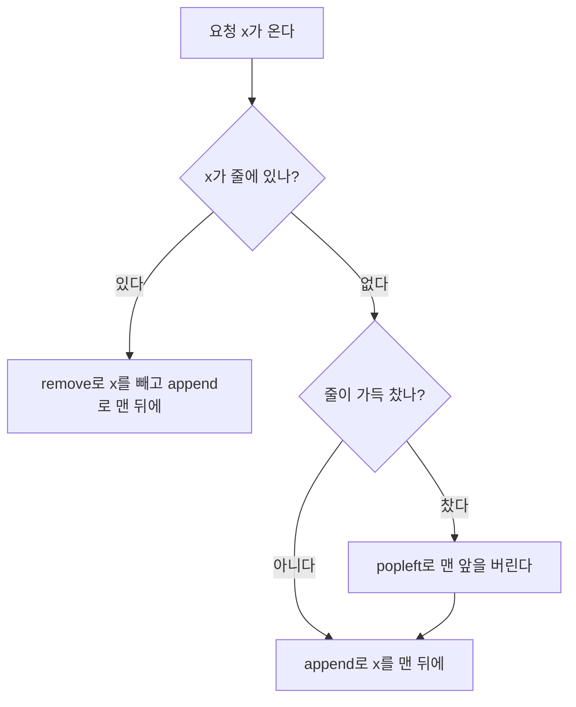

# 큐와 덱 (Queue and Deque)

> [!summary]
> 매표소 줄처럼 먼저 온 사람이 먼저 나가는 것이 큐다. 이 규칙을 선입선출(FIFO)이라 부른다. 파이썬의 `deque`는 줄의 양쪽 끝에서 넣고 빼는 일이 모두 한 번에 끝나서, 큐로도 스택으로도 양쪽을 다 쓰는 줄(덱)로도 쓴다. 리스트로 큐를 만들면 앞에서 뺄 때마다 나머지를 한 칸씩 당겨야 해서 느리다. 대신 덱도 가운데 원소를 꺼내거나 찾는 일은 느리다.

## 예시로 보기

은행 창구 줄이다. 손님 A, B, C가 차례로 오고, 창구는 한 명씩 부른다.

| 일 | 코드 | 줄 (왼쪽이 맨 앞) |
|---|---|---|
| A 도착 | `q.append("A")` | A |
| B 도착 | `q.append("B")` | A B |
| 한 명 부르기 | `q.popleft()` → A | B |
| C 도착 | `q.append("C")` | B C |
| 한 명 부르기 | `q.popleft()` → B | C |

넣기는 뒤(오른쪽)에, 빼기는 앞(왼쪽)에서 한다. [[알고리즘/3.개념집/10.스택|스택]]은 넣고 빼는 쪽이 같아서 가장 최근 것이 나오고, 큐는 반대쪽이라 가장 오래된 것이 나온다.

## 쓰는 법

```python
from collections import deque
q = deque()            # 빈 덱
q = deque([1, 2, 3])   # 리스트로 만들기
```

| 코드 | 하는 일 | 비용 |
|---|---|---|
| `q.append(x)`, `q.appendleft(x)` | 오른쪽, 왼쪽 끝에 넣기 | $O(1)$ |
| `q.pop()`, `q.popleft()` | 오른쪽, 왼쪽 끝에서 빼기 | $O(1)$ |
| `q[0]`, `q[-1]` | 양 끝 보기 | $O(1)$ |
| `q[i]` (가운데) | 가운데 원소 보기 | $O(n)$ |
| `x in q`, `q.remove(x)` | 찾기, 지우기 | $O(n)$ |
| `q.rotate(k)` | 오른쪽으로 k칸 돌리기(끝에서 빼서 앞에 넣기를 k번) | $O(k)$ |
| `deque(maxlen=k)` | 길이가 k를 넘으면 반대쪽 끝을 자동으로 버리는 덱 | |

리스트로도 `a.pop(0)`을 쓰면 큐가 되지만, 앞을 뺄 때마다 나머지 전부를 한 칸씩 당겨서 $O(n)$이다. 공식 튜토리얼도 큐에는 `deque`를 쓰라고 한다. [[알고리즘/3.개념집/03.리스트와 문자열|리스트와 문자열]] 문서의 측정에서 원소 10만 개일 때 `pop(0)`은 `pop()`보다 약 500배 느렸다.

## 가장 오래 안 쓴 것 버리기 (LRU)

크기가 정해진 보관함이 가득 찼을 때 "가장 오래 안 쓴 것"을 버리는 규칙을 LRU(Least Recently Used)라고 한다. 덱으로 이렇게 만든다.

- 줄을 "쓴 순서"로 유지한다. 맨 앞이 가장 오래 안 쓴 것, 맨 뒤가 방금 쓴 것이다.
- 이미 있는 것을 쓰면: 줄에서 빼서(`remove`) 맨 뒤로 다시 넣는다(`append`).
- 없는 것을 넣는데 가득 찼으면: 맨 앞을 버린다(`popleft`).



어느 길로 가든 마지막에 x는 줄의 맨 뒤에 선다. 버리는 일은 x가 줄에 없고 줄이 가득 찼을 때만 생긴다.

`remove`가 $O(k)$라서 보관함 크기 k가 작을 때 알맞다. k가 크면 넣은 순서를 기억하는 딕셔너리 `OrderedDict`의 `move_to_end`(맨 뒤로 옮기기)와 `popitem(last=False)`(맨 앞 빼기)로 모든 일을 평균 $O(1)$에 한다.

> [!check] 검증: 예시 표의 줄 상태, 표의 동작(rotate, maxlen 포함), 덱 LRU와 `OrderedDict` LRU가 무작위 요청 3,000묶음에서 같은 적중·실패를 내는 것을 확인했다. `deque.popleft`가 `list.pop(0)`보다 원소 10만 개에서 수십 배 이상 빠른 것도 쟀다 — [[알고리즘/3.개념집/11_queue-deque_impl.py|11_queue-deque_impl.py]]

## 활용

- 먼저 온 순서대로 처리하는 모든 일: 작업 대기열, 프린터 줄, 가까운 곳부터 퍼져 나가는 탐색(BFS). BFS는 [[알고리즘/3.개념집/24.너비 우선 탐색(BFS)|너비 우선 탐색(BFS)]] 문서에서 다룬다.
- 캐시(LRU), 최근 k개만 기억하기(`maxlen`), 원형으로 돌리기(`rotate`).
- 고르는 기준: 가장 최근 것부터면 스택, 가장 오래된 것부터면 큐, 양쪽을 다 쓰면 덱이다. 가운데를 자주 건드리면 덱도 느리니 다른 구조(딕셔너리, [[알고리즘/3.개념집/13.연결 리스트|연결 리스트]])를 찾는다.

## 연결

- 선수: [[알고리즘/3.개념집/03.리스트와 문자열|리스트와 문자열]], [[알고리즘/3.개념집/02.시간 복잡도로 방법 고르기|시간 복잡도로 방법 고르기]]
- 대조: [[알고리즘/3.개념집/10.스택|스택]]은 마지막에 넣은 것을 먼저 꺼낸다.
- 연습: [[알고리즘/4.연습문제/11.캐시|캐시]], [[알고리즘/4.연습문제/11.행렬과 연산|행렬과 연산]]

## 확인 문제

<!-- type: trace -->
> [!question]- **C1** `q = deque([1, 2, 3])`에 `q.append(4)`, `q.popleft()`, `q.appendleft(0)`, `q.rotate(1)`을 차례로 하면 q는?
> **답:** `deque([4, 0, 2, 3])`. [1, 2, 3, 4] → [2, 3, 4] → [0, 2, 3, 4] → 오른쪽으로 한 칸 돌리면 끝의 4가 맨 앞으로 와서 [4, 0, 2, 3]이다.

<!-- type: why -->
> [!question]- **C2** 리스트의 `pop(0)`은 느리고 덱의 `popleft()`는 빠른 까닭은?
> **답:** 리스트는 원소를 번호 순서대로 붙은 칸에 둔다. 맨 앞을 빼면 번호를 맞추려고 나머지 모두를 한 칸씩 당겨야 해서 $O(n)$이다. 덱은 양쪽 끝을 따로 관리하는 구조라 맨 앞을 빼도 다른 원소를 옮길 필요가 없어 $O(1)$이다.

<!-- type: discriminate -->
> [!question]- **C3** 크기 2인 LRU 보관함에 A, B, A, C를 차례로 넣으면 마지막에 무엇이 남는가? 같은 요청을 "먼저 넣은 것부터 버리기(FIFO)"로 하면?
> **답:** LRU는 {A, C}. 세 번째 요청 A가 A를 "방금 쓴 것"으로 만들어서, C가 올 때 가장 오래 안 쓴 B가 버려진다. FIFO는 {B, C}. 다시 써도 순서가 바뀌지 않아서 가장 먼저 넣은 A가 버려진다.
