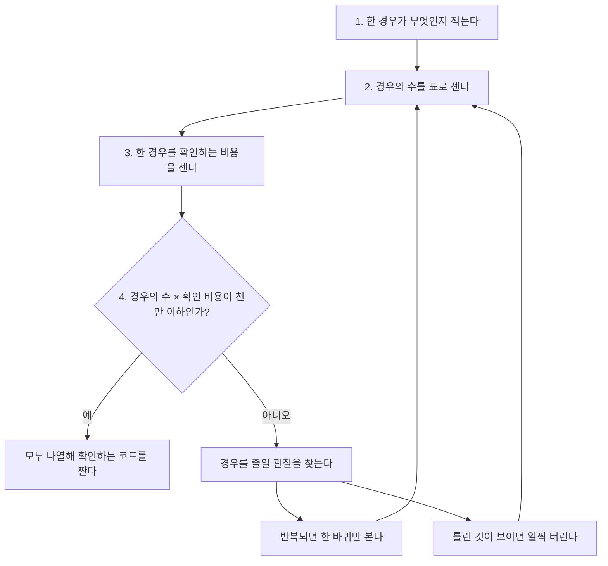

# 완전탐색 (Brute Force)

> [!summary]
> 비밀번호를 잊은 세 자리 자물쇠를 000부터 999까지 모두 돌려 보는 것과 같다. 가능한 경우를 빠짐없이 만들어 하나씩 확인하므로, 생각할 것이 가장 적고 틀릴 일도 적다. 그래서 경우의 수가 작으면 가장 먼저 고른다. 대신 경우의 수는 조금만 커져도 폭발하므로, 짜기 전에 몇 가지인지 반드시 먼저 센다.

## 예시로 보기

카드 [1, 2, 3, 4] 중 두 장을 골라 합이 5가 되는 경우를 모두 찾는다.

| 고른 두 장 | 합 | 5인가 |
|---|---|---|
| 1, 2 | 3 | |
| 1, 3 | 4 | |
| 1, 4 | 5 | 예 |
| 2, 3 | 5 | 예 |
| 2, 4 | 6 | |
| 3, 4 | 7 | |

두 장을 고르는 경우는 $\binom{4}{2} = 6$($\binom{\ }{\ }$은 위의 수만큼 있는 것에서 아래의 수만큼 고르는 경우의 수)가지다. 6가지를 모두 확인했으니 빠진 답이 없다. 카드가 1,000장이어도 두 장 고르기는 약 50만 가지라 다 해 볼 수 있다. 하지만 "몇 장이든 골라서"라면 $2^{1000}$가지라 불가능하다.

## 경우의 수 세기

무엇을 나열하는지에 따라 개수가 크게 다르다.

| 나열하는 것 | 개수 | n = 10일 때 | 파이썬 도구 |
|---|---|---|---|
| 자리마다 k가지 중 하나를 n자리 | $k^n$ | $2^{10} = 1024$ | `product(값들, repeat=n)` |
| n개를 한 줄로 세우는 순서 | $n!$ | 3,628,800 | `permutations(a)` |
| n개 중 r개를 순서 있게 | $n!/(n-r)!$ | r = 3이면 720 | `permutations(a, r)` |
| n개 중 r개를 순서 없이 | $\binom{n}{r}$ | r = 3이면 120 | `combinations(a, r)` |
| n개의 모든 부분집합 | $2^n$ | 1024 | 비트마스크나 `combinations`를 r마다 |

```python
from itertools import product, permutations, combinations

list(product([0, 1], repeat=2))   # [(0,0), (0,1), (1,0), (1,1)]
list(permutations("abc", 2))      # [('a','b'), ('a','c'), ('b','a'), ('b','c'), ('c','a'), ('c','b')]
list(combinations("abc", 2))      # [('a','b'), ('a','c'), ('b','c')]
```

순서가 결과를 바꾸면(누가 먼저 가는가, 어떤 순서로 계산하는가) 순열, 바꾸지 않으면(누구를 뽑는가) 조합이다.

## 짜기 전 네 가지 질문

1. **무엇을 나열하나?** 한 경우가 무엇인지 정확히 적는다. 예: "연산자 세 개의 우선순위 순서 하나".
2. **몇 가지인가?** 위 표로 센다.
3. **한 경우를 확인하는 비용은?** 예: 식을 한 번 계산하는 데 길이만큼.
4. **곱이 천만 이하인가?** (경우의 수) × (확인 비용)을 [[알고리즘/3.개념집/02.시간 복잡도로 방법 고르기|시간 복잡도]]의 기준에 맞춘다.

넘치면 경우를 줄일 관찰을 찾는다. 대표적인 두 가지가 있다.
- **답이 될 수 없는 경우는 일찍 버린다.** 선택을 하나씩 쌓다가 이미 틀린 것이 보이면 더 쌓지 않는다. 이것이 백트래킹이다. [[알고리즘/3.개념집/17.재귀와 백트래킹|재귀와 백트래킹]] 문서에서 다룬다.



관찰로 경우를 줄였으면 2번으로 돌아가 다시 센다. 곱이 천만 아래로 내려올 때 비로소 짠다.

> [!check] 검증: 예시(합이 5인 쌍 2개), 표의 개수 공식(n ≤ 8, r ≤ n의 모든 경우에서 itertools가 만든 개수와 일치), 코드 예의 출력, "주기 p와 q로 도는 두 상태를 합친 것은 lcm(p, q)마다 되풀이된다"(p, q ≤ 20의 모든 쌍)를 확인했다 — [[알고리즘/3.개념집/16_brute-force_verify.py|16_brute-force_verify.py]]

## 활용

- 제한이 아주 작은 문제(n ≤ 8~10의 순서, n ≤ 20의 부분집합, 격자 5 × 5 등)는 먼저 완전탐색을 의심한다.
- 빠른 풀이를 짠 뒤, 작은 입력에서 완전탐색과 결과를 비교하면 빠른 풀이의 틀린 곳을 찾을 수 있다. 이 볼트의 모든 풀이 코드가 그렇게 검증한다.
- 자주 하는 실수: 경우의 수를 세지 않고 짜서 시간 초과가 난다. 순열과 조합을 헷갈려 같은 경우를 여러 번 세거나 빠뜨린다.

## 연결

- 다음 개념: [[알고리즘/3.개념집/17.재귀와 백트래킹|재귀와 백트래킹]](나열을 직접 짜고, 일찍 버리기), 부분집합은 [[알고리즘/3.개념집/09.비트 연산과 비트마스크|비트마스크]]로도 돈다.
- 연습: [[알고리즘/4.연습문제/16.노란불 신호등|노란불 신호등]], [[알고리즘/4.연습문제/16.자물쇠와 열쇠|자물쇠와 열쇠]], [[알고리즘/4.연습문제/16.외벽 점검|외벽 점검]]

## 확인 문제

<!-- type: apply -->
> [!question]- **C1** 서로 다른 원소 5개로 길이 3인 순서 있는 나열을 만들면 몇 개인가? 이를 만드는 itertools 함수는?
> **답:** 5 × 4 × 3 = 60개. `permutations(a, 3)`이다.

<!-- type: discriminate -->
> [!question]- **C2** (가) 학생 6명 중 대표 2명 뽑기, (나) 6명을 발표 순서대로 세우기, (다) 비밀번호 네 자리를 0~9로 만들기. 각각 어떤 도구와 개수인가?
> **답:** (가) `combinations`, $\binom{6}{2} = 15$. 누가 뽑히는지만 중요하다. (나) `permutations`, 6! = 720. 순서가 결과를 바꾼다. (다) `product(range(10), repeat=4)`, 10⁴ = 10,000. 같은 숫자를 다시 써도 된다.

<!-- type: why -->
> [!question]- **C3** 초록·노랑·빨강 주기가 각각 5초와 6초인 신호등 두 개가 있다. "둘이 동시에 노란불인 순간"을 찾을 때 30초까지만 확인하면 되는 까닭은?
> **답:** 두 신호등을 합친 상태는 30초(5와 6의 최소공배수)마다 처음과 똑같이 되풀이된다. 30초 안에 동시에 노란불인 순간이 없으면 그 뒤에도 같은 모습이 되풀이될 뿐이라 영원히 없다.
