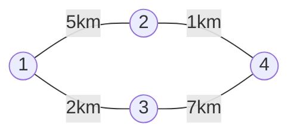

# 그래프 표현 (Graph Representation)

> [!summary]
> 지하철 노선도를 코드로 옮기는 방법이다. 역마다 "바로 갈 수 있는 역 목록"을 적어 두는 인접 리스트가 기본이다. 역이 몇백 개 이하이고 "두 역이 바로 이어졌나"를 자주 물으면 표(인접 행렬)를 쓴다. 격자 지도는 따로 옮기지 않고 칸 자체를 역으로 본다. 번호가 1부터인지, 길이 양방향인지를 잘못 옮기는 실수가 가장 흔하다.

## 예시로 보기

도시 1 ~ 4와 양방향 도로 1–2(5km), 1–3(2km), 2–4(1km), 3–4(7km)가 있다. 문제는 보통 이것을 **간선 목록**으로 준다: `[[1, 2, 5], [1, 3, 2], [2, 4, 1], [3, 4, 7]]`.



동그라미가 도시(점), 선이 도로(간선)다. 아래의 인접 리스트와 인접 행렬은 모두 이 그림 하나를 다르게 적은 것이다.

**인접 리스트**로 옮기면 도시마다 (이웃, 거리) 목록이 생긴다. 번호가 1부터라 칸을 n + 1개 만들고 0번은 비워 둔다.

```python
n = 4
graph = [[] for _ in range(n + 1)]
for a, b, w in edges:
    graph[a].append((b, w))
    graph[b].append((a, w))      # 양방향이면 반대쪽도 넣는다
# graph[1] = [(2, 5), (3, 2)], graph[4] = [(2, 1), (3, 7)]
```

**인접 행렬**로 옮기면 (n + 1)×(n + 1) 표의 M[a][b]에 거리를 적는다. 길이 없으면 무한대(`float("inf")`), 자기 자신은 0이다.

| | 1 | 2 | 3 | 4 |
|---|---|---|---|---|
| 1 | 0 | 5 | 2 | ∞ |
| 2 | 5 | 0 | ∞ | 1 |
| 3 | 2 | ∞ | 0 | 7 |
| 4 | ∞ | 1 | 7 | 0 |

인접 리스트의 목록 길이를 모두 더하면 8이다.

## 세 가지 방식과 격자

| | 인접 리스트 | 인접 행렬 | 간선 목록 |
|---|---|---|---|
| 메모리 | $O(n + m)$ | $O(n^2)$ | $O(m)$ |
| v의 이웃 모두 보기 | $O(\deg v)$ | $O(n)$ | $O(m)$ |
| a–b가 이어졌나 | $O(\deg a)$ | $O(1)$ | $O(m)$ |
| 알맞은 곳 | 대부분(BFS, 다익스트라) | n ≤ 수백, 플로이드–워셜 | 간선을 정렬해 쓰는 알고리즘 |

n은 점 수, m은 간선 수, deg v는 v에 붙은 간선 수다. 점이 10만 개면 인접 행렬은 칸이 100억 개라 만들 수 없다.

**격자:** 미로 같은 격자는 칸 (r, c)가 점이고, 벽이 아닌 상하좌우 이웃과 이어진다. 그래프를 따로 만들지 않고, 이웃을 그때그때 방향 목록으로 만든다.

```python
for dr, dc in ((1, 0), (-1, 0), (0, 1), (0, -1)):
    nr, nc = r + dr, c + dc
    if 0 <= nr < R and 0 <= nc < C and grid[nr][nc] == 0:
        ...                      # (nr, nc)가 이웃
```

**상태를 점으로 보기:** 점이 꼭 "장소"일 필요는 없다. "위치와 바라보는 방향", "로봇이 차지한 두 칸"처럼 문제의 상태 하나를 점으로, 한 번의 동작을 간선으로 보면 같은 탐색을 그대로 쓴다. 이때도 그래프를 미리 만들지 않고, 상태에서 갈 수 있는 다음 상태를 그때그때 만든다.

> [!check] 검증: 예시의 인접 리스트·행렬, 목록 길이의 합 = 간선 수의 두 배, 확인 문제 C1·C3의 답, 격자 이웃 수(모서리 2, 가장자리 3, 안쪽 4)를 확인했다. 무작위 그래프 1,000개에서 인접 리스트와 인접 행렬이 같은 간선과 가중치를 나타냈다 — [[알고리즘/3.개념집/23_graph-representation_verify.py|23_graph-representation_verify.py]]

## 활용

- [[알고리즘/3.개념집/24.너비 우선 탐색(BFS)|너비 우선 탐색(BFS)]], [[알고리즘/3.개념집/26.다익스트라|다익스트라]]는 인접 리스트로, [[알고리즘/3.개념집/27.플로이드–워셜|플로이드–워셜]]은 인접 행렬로 짠다.
- 딕셔너리로도 만든다: `graph = defaultdict(list)`. 점 이름이 문자열이거나 번호가 띄엄띄엄일 때 편하다. [[알고리즘/3.개념집/04.딕셔너리와 집합|딕셔너리와 집합]] 참고.
- **흔한 실수:** 1부터 번호를 매기는데 칸을 n개만 만들어 범위를 넘는다. 양방향인데 한쪽만 넣는다. 같은 두 점 사이에 간선이 여러 개인데 행렬에 마지막 값만 남긴다(보통 가장 작은 값을 남겨야 한다). `[[]] * n`으로 만들어 모든 칸이 같은 리스트가 된다.

## 확인 문제

<!-- type: trace -->
> [!question]- **C1** 점 1 ~ 4와 방향 간선 [1, 2], [2, 3], [3, 1], [3, 4]를 인접 리스트(이웃 번호만)로 쓰라.
> **답:** graph[1] = [2], graph[2] = [3], graph[3] = [1, 4], graph[4] = []. 방향 간선이라 반대쪽은 넣지 않는다. graph[0]은 비어 있다.

<!-- type: discriminate -->
> [!question]- **C2** 두 상황에 인접 리스트와 인접 행렬 중 무엇을 쓰는가? (가) 점 10만 개, 간선 20만 개에서 한 점부터 최단 거리를 구한다. (나) 점 200개에서 모든 점 쌍의 최단 거리를 구한다.
> **답:** (가)는 인접 리스트다. 행렬이면 칸이 100억 개라 만들 수조차 없다. (나)는 인접 행렬이다. 칸이 4만 개라 넉넉하고, 모든 쌍을 다루는 플로이드–워셜이 행렬 위에서 돈다.

<!-- type: counterexample -->
> [!question]- **C3** 양방향 도로 `[2, 1]` 하나만 있는 그래프를 한쪽 방향(`graph[2].append(1)`)으로만 넣었다. 1에서 출발한 탐색은 무엇을 틀리는가?
> **답:** 1에서 2로 갈 수 없다고 답한다. graph[1]이 비어 있어 1의 이웃이 없기 때문이다. 양방향이면 `graph[1].append(2)`도 넣어야 한다.
