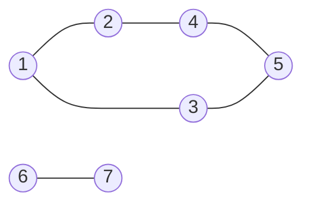
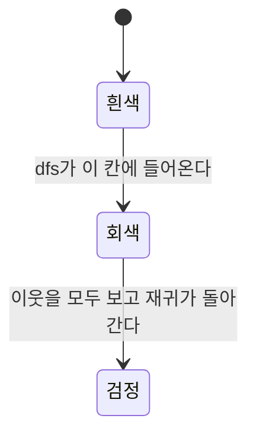

# 깊이 우선 탐색(DFS) (Depth-First Search)

> [!summary]
> 미로에서 한 길을 막힐 때까지 끝까지 가 보고, 막히면 마지막 갈림길로 돌아와 다른 길을 가는 방식이다. 출발점에서 닿을 수 있는 곳을 빠짐없이 한 번씩 돌아, 연결된 덩어리를 찾거나 사이클이 있는지 볼 때 쓴다. 코드가 재귀로 짧게 써진다. 대신 처음 닿은 길이 가장 짧은 길이라는 보장은 없고, 파이썬 재귀는 깊이 1,000 근처에서 멈춘다.

## 예시로 보기

무방향 그래프 1–2, 1–3, 2–4, 4–5, 3–5, 6–7에서 1부터 DFS를 한다(이웃은 번호 순).



1, 2, 4, 5, 3은 고리 하나로 이어져 있고, 6–7은 따로 떨어진 덩어리다.

| 지금 칸 | 아직 안 간 이웃 | 한 일 | 재귀로 쌓인 길 |
|---|---|---|---|
| 1 | 2, 3 | 2로 들어감 | 1 |
| 2 | 4 | 4로 들어감 | 1 → 2 |
| 4 | 5 | 5로 들어감 | 1 → 2 → 4 |
| 5 | 3 | 3으로 들어감 | 1 → 2 → 4 → 5 |
| 3 | 없음(1, 5는 갔음) | 5로 돌아감 → 4 → 2 → 1 | 1 → 2 → 4 → 5 → 3 |
| 1 | 없음 | 끝 | |

방문 순서는 1, 2, 4, 5, 3이다. 3은 1의 바로 이웃인데도 가장 늦게 간다. 한 길(2 → 4 → 5)을 끝까지 판 뒤에야 5를 통해 3에 닿기 때문이다. 6, 7은 1에서 닿지 않는 다른 덩어리다.

## 정의

> [!definition] 입력과 출력
> - **입력:** 그래프 $G = (V, E)$(인접 리스트)와 출발점 $s$.
> - **출력:** $s$에서 간선을 따라 닿을 수 있는 모든 점을 한 번씩 방문한 순서.

```python
def dfs(graph, v, seen, out):
    seen.add(v)
    out.append(v)
    for u in graph[v]:
        if u not in seen:
            dfs(graph, u, seen, out)     # 한 이웃으로 끝까지 들어간다
```

재귀 대신 스택으로도 짠다. 꺼낼 때 방문 표시를 하고 이웃을 거꾸로 넣으면 재귀와 같은 순서가 나온다. 깊이가 수천 이상이면 스택 방식이 안전하다.

닿을 수 있는 점을 모두 방문하는 까닭: s에서 v로 가는 길 s = x₀, x₁, …, x_k = v가 있다고 하자. x₀은 방문한다. x_i를 방문하면 그 이웃 목록을 다 훑으니, x_{i+1}은 그때 방문하거나 이미 방문했다. 귀납적으로 v도 방문한다.

> [!check] 검증: 예시와 확인 문제 C1의 방문 순서, C3의 다이아몬드 그래프를 코드로 확인했다. 무작위 그래프 2,000개에서 재귀와 스택 방식의 순서가 같았고, 덩어리 수가 BFS로 센 수와, 세 가지 색 사이클 판정이 위상 정렬(칸 판정)과 같았다. 점 2,000개가 한 줄로 이어지면 재귀 DFS가 기본 재귀 한도에서 `RecursionError`를 내는 것도 확인했다 — [[알고리즘/3.개념집/25_dfs_impl.py|25_dfs_impl.py]]

## 활용

- **비용:** 점마다 한 번 방문하고 이웃 목록을 한 번 훑어 $O(n + m)$이다.
- **연결 덩어리 세기:** 아직 안 간 점마다 DFS를 한 번씩 시작하면, 시작한 횟수가 덩어리 수다(확인 문제 C2).
- **방향 그래프의 사이클:** 칸을 세 가지 색으로 둔다. 아직(흰색), 탐색 중(회색: 재귀가 아직 이 칸 안에 있음), 끝남(검정). 탐색 중에 회색 칸을 다시 만나면 사이클이다. 검정 칸을 만나는 것은 사이클이 아니다(확인 문제 C3).



칸 하나의 색은 흰색, 회색, 검정 순서로 한 번씩만 바뀌고 되돌아가지 않는다. 그래서 회색 칸은 지금 재귀가 지나오는 길 위에 있는 칸들뿐이다.
- **고르는 기준:** 최단 거리가 필요하면 [[알고리즘/3.개념집/24.너비 우선 탐색(BFS)|BFS]]다. 닿는 곳을 모두 보기만 하면 둘 다 되고, 사이클·위상 정렬·트리의 아래쪽부터 계산하기는 DFS가 자연스럽다.
- **흔한 실수:** 방향 그래프에서 "이미 방문한 점을 다시 만나면 사이클"로 판정한다. 깊은 그래프에서 재귀 한도를 늘리지 않는다. 방문 표시를 재귀 호출 뒤에 해 같은 점을 여러 번 들어간다.

## 연결

- 선수: [[알고리즘/3.개념집/17.재귀와 백트래킹|재귀와 백트래킹]], [[알고리즘/3.개념집/23.그래프 표현|그래프 표현]]
- 백트래킹은 "선택의 나무"를 DFS로 도는 것이다. DFS는 그 나무가 그래프일 때 같은 점을 두 번 가지 않게 방문 표시를 더한 것이다.

## 확인 문제

<!-- type: trace -->
> [!question]- **C1** 무방향 간선 1–2, 1–5, 2–3, 2–4, 5–6에서 1부터 DFS를 할 때(이웃은 번호 순) 방문 순서는?
> **답:** 1, 2, 3, 4, 5, 6. 2로 들어가 3을 다 보고 2로 돌아와 4, 다시 1로 돌아와 5, 6 순서다. BFS였다면 1, 2, 5, 3, 4, 6이다.

<!-- type: explain -->
> [!question]- **C2** 다음 코드가 돌려주는 값을 한 문장으로 말하라.
> ```python
> def f(n, graph):
>     seen, cnt = [False] * n, 0
>     for s in range(n):
>         if not seen[s]:
>             cnt += 1
>             stack = [s]
>             seen[s] = True
>             while stack:
>                 v = stack.pop()
>                 for u in graph[v]:
>                     if not seen[u]:
>                         seen[u] = True
>                         stack.append(u)
>     return cnt
> ```
> **답:** 무방향 그래프의 연결 덩어리(연결 성분) 수다. 아직 안 간 점에서 탐색을 시작할 때마다 새 덩어리를 하나 세고, 그 덩어리의 점을 모두 방문 표시한다.

<!-- type: counterexample -->
> [!question]- **C3** 방향 그래프에서 "이미 방문한 점을 다시 만나면 사이클"이라고 판정하면 틀리는 예를 들어라.
> **답:** a → b, a → c, b → d, c → d(다이아몬드). a에서 b, d를 방문하고 돌아온 뒤 c에서 d를 다시 만난다. d는 이미 방문했지만 사이클은 없다. d는 탐색이 끝난(검정) 칸이기 때문이다. 탐색 중인(회색) 칸을 다시 만날 때만 사이클이다.

<!-- type: apply -->
> [!question]- **C4** 점 9개, 간선 12개인 연결 그래프를 한 점에서 깊이 우선 탐색한다. (가) 새 점으로 처음 들어갈 때 쓴 간선은 모두 몇 개이고, 그 간선들은 무엇을 이루는가? (나) 이웃을 찾느라 인접 행렬에서는 칸을 몇 개, 인접 리스트에서는 원소를 몇 개 보는가?
> **답:** (가) 8개. 점 9개를 모두 잇고 고리가 없는 나무, 곧 깊이 우선 신장 트리다. (나) 인접 행렬은 점마다 한 줄 9칸을 다 봐서 $9 \times 9 = 81$칸, 인접 리스트는 목록 길이의 합인 $2 \times 12 = 24$개다.
> **이유:** 출발점을 뺀 여덟 점이 저마다 간선 하나를 타고 처음 방문된다. 행렬은 간선이 없는 칸도 봐야 해서 $O(n^2)$, 리스트는 있는 간선만 봐서 $O(n + m)$이다. 간선이 적을수록 차이가 커진다.
