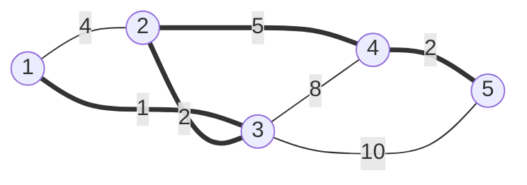

# 최소 신장 트리 (Minimum Spanning Tree)

> [!summary]
> 섬들을 다리로 모두 잇되, 다리 값의 합을 가장 적게 하고 싶다. 가장 싼 다리부터 보며, 이미 이어진 두 섬 사이의 다리면 건너뛰고 아니면 놓는다(크루스칼). 결과는 고리 없이 모든 섬을 잇는 나무가 되고, 섬이 n개면 다리는 n − 1개다. 단, 모든 섬이 이어질 수 있는 그래프여야 하고, 이렇게 만든 나무 위의 길이 두 섬 사이의 가장 짧은 길은 아니다.

## 예시로 보기

점 1 ~ 5와 간선 1–2(4), 1–3(1), 2–3(2), 2–4(5), 3–4(8), 3–5(10), 4–5(2)가 있다. 크루스칼은 간선을 비용 순으로 보며, 두 끝이 이미 같은 무리인지 [[알고리즘/3.개념집/15.유니온 파인드|유니온 파인드]]로 묻는다.

| 간선 (비용) | 두 끝이 이미 이어졌나 | 한 일 | 무리 |
|---|---|---|---|
| 1–3 (1) | 아니다 | 고름 | {1, 3} |
| 2–3 (2) | 아니다 | 고름 | {1, 2, 3} |
| 4–5 (2) | 아니다 | 고름 | {1, 2, 3} {4, 5} |
| 1–2 (4) | 이어졌다 | 건너뜀(고리가 생긴다) | |
| 2–4 (5) | 아니다 | 고름 | {1, 2, 3, 4, 5} |
| 3–4 (8), 3–5 (10) | 이어졌다 | 건너뜀 | |

고른 간선 4개의 합은 1 + 2 + 2 + 5 = 10이다.



굵은 선이 고른 간선 4개이고, 가는 선이 건너뛴 간선 3개다. 가는 선을 하나라도 더하면 굵은 선과 함께 고리가 생긴다.

```python
def kruskal(n, edges):                  # edges: (a, b, w), 점은 1 ~ n
    parent = list(range(n + 1))
    def find(x):
        while parent[x] != x:
            parent[x] = parent[parent[x]]   # 가는 길에 한 칸씩 건너뛰게 줄인다
            x = parent[x]
        return x
    total = 0
    for a, b, w in sorted(edges, key=lambda e: e[2]):
        ra, rb = find(a), find(b)
        if ra != rb:                    # 다른 무리면 잇는다
            parent[rb] = ra
            total += w
    return total
```

## 맞는 이유

**자르기 성질(cut property):** 점들을 두 편으로 나눴을 때, 두 편을 잇는 간선 중 가장 싼 간선은 어떤 최소 신장 트리에 들어 있다.

> [!proof]- 증명 펼치기
> 1. 두 편을 잇는 가장 싼 간선을 e라 하자. 최소 신장 트리 T가 e를 쓰지 않는다고 하자.
> 2. T에 e를 더하면 고리가 하나 생긴다. 그 고리는 두 편을 오가므로, e 말고도 두 편을 잇는 간선 f를 하나 지난다.
> 3. f를 빼면 다시 모든 점을 잇는 나무가 된다. e는 가장 싼 간선이라 비용 합은 늘지 않는다.
> 4. 그래서 e를 쓰는 최소 신장 트리가 있다. ∎

크루스칼이 간선 a–b를 고르는 순간, "a의 무리"와 "나머지"로 나눈 두 편을 잇는 간선 중 a–b가 가장 싸다(더 싼 간선은 이미 다 봤고, 그중 두 편을 잇는 것은 없었다). 그래서 자르기 성질에 따라 고른 간선이 늘 안전하다. 이것은 [[알고리즘/3.개념집/22.그리디|그리디]]의 바꿔치기 논증이다.

**프림:** 한 점에서 시작해, "지금까지 이은 점들"과 "아직인 점들"을 잇는 가장 싼 간선을 힙으로 골라 하나씩 붙인다. 자르기 성질을 그대로 쓴 방법이다.

> [!check] 검증: 예시 표의 고름·건너뜀 순서와 합 10, 확인 문제 C1·C3의 답을 코드로 확인했다. 무작위 연결 그래프 1,500개(점 6개 이하)에서 크루스칼과 프림의 합이 "간선 n − 1개를 모두 골라 나무가 되는 것 중 가장 싼 것"과 같았다 — [[알고리즘/3.개념집/28_mst_verify.py|28_mst_verify.py]]

## 활용

- **비용:** 크루스칼은 간선 정렬 $O(m \log m)$ + 유니온 파인드, 프림은 힙으로 $O(m \log m)$이다. 간선이 적으면 크루스칼이 짧고, 격자처럼 간선을 그때그때 만들 때는 프림이 편하다.
- **쓰는 곳:** 전선·수도관·통신망을 가장 싸게 까는 설계, 비슷한 것끼리 묶기(비용이 큰 간선 몇 개를 빼면 무리가 나뉜다).
- **흔한 실수:** 무리를 확인하지 않아 고리를 만든다. 그래프가 연결되지 않았는데 결과를 그대로 쓴다(고른 간선이 n − 1개인지 확인한다). [[알고리즘/3.개념집/26.다익스트라|다익스트라]]의 최단 경로 트리와 헷갈린다(확인 문제 C3).

## 연결

- 가장 싼 것부터 고르고 되돌리지 않는 [[알고리즘/3.개념집/22.그리디|그리디]]가 맞는 대표적인 예다.
- 연습: [[알고리즘/4.연습문제/28.지형 이동|지형 이동]]

## 확인 문제

<!-- type: trace -->
> [!question]- **C1** 간선 1–2(3), 1–3(1), 1–4(4), 2–3(2), 3–4(5)에 크루스칼을 돌린다. 고르는 간선과 비용 합은?
> **답:** 1–3(1), 2–3(2)을 고르고, 1–2(3)는 1과 2가 이미 이어져 건너뛴다. 1–4(4)를 고르면 네 점이 모두 이어진다. 합은 7이다. 3–4(5)는 볼 필요도 없이 건너뛴다.

<!-- type: explain -->
> [!question]- **C2** 크루스칼 코드에서 `if ra != rb:` 한 줄이 하는 일을 한 문장으로 말하라.
> **답:** 간선의 두 끝이 이미 같은 무리(이미 이어진 상태)면 그 간선을 넣지 않아 고리가 생기지 않게 한다. 다른 무리일 때만 간선을 넣고 두 무리를 합친다.

<!-- type: discriminate -->
> [!question]- **C3** 간선 A–B(2), B–C(2), A–C(3)에서 최소 신장 트리를 구하고, 그 나무 위의 A에서 C로 가는 길과 A에서 C로 가는 최단 경로를 비교하라.
> **답:** 최소 신장 트리는 A–B, B–C(합 4)다. 나무 위의 A → C는 A–B–C로 4다. 최단 경로는 A–C 바로 3이다. 최소 신장 트리는 "모두 잇는 비용의 합"을, 최단 경로는 "두 점 사이 길의 비용"을 줄인다. 목적이 다르니 같은 나무가 나오지 않는다.

<!-- type: why -->
> [!question]- **C4** 간선 비용이 모두 다르면 최소 신장 트리가 하나뿐인 까닭은? 비용이 같은 간선이 있으면 여럿일 수 있음을 보이는 예도 하나 들어라.
> **답:** 서로 다른 최소 신장 트리 $T_1$, $T_2$가 있다고 하자. 둘 가운데 한쪽에만 있는 간선들 중 가장 싼 것을 $e$라 하고, $e$가 $T_1$에 있다고 하자. $T_2$에 $e$를 더하면 고리가 하나 생긴다. $T_1$에는 고리가 없으니, 그 고리에는 $T_1$에 없는 간선 $f$가 있다. $f$는 $T_2$에만 있는 간선이라 $e$보다 비싸다. $T_2$에서 $f$를 빼고 $e$를 넣으면 더 싼 신장 트리가 되어 $T_2$가 최소라는 것과 어긋난다. 예: 삼각형의 세 간선이 모두 1이면 어느 둘을 골라도 비용이 2라서 최소 신장 트리가 셋이다.
> **이유:** "$f$가 $e$보다 비싸다"에서 비용이 모두 다르다는 조건을 쓴다. 같아도 되면 $f$와 $e$의 비용이 같을 수 있어 어긋남이 생기지 않는다.
