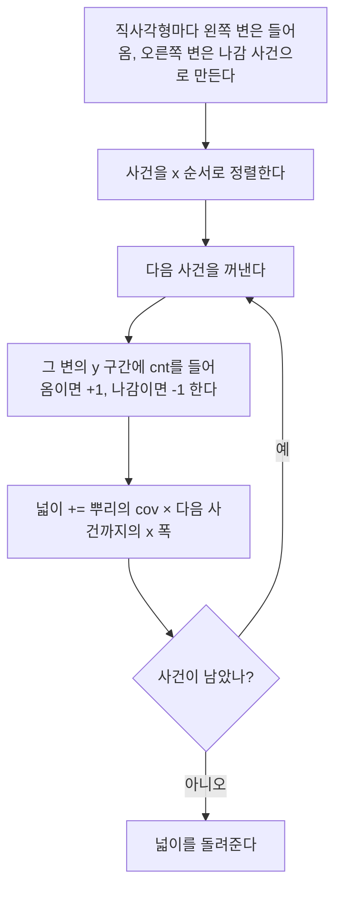

# 세그먼트 트리와 스위핑 (Segment Tree, Sweep Line)

> [!summary]
> 반 대표, 학년 대표, 전교 대표가 각자 맡은 학생들의 점수 합을 들고 있다고 하자. 한 학생 점수가 바뀌면 그 위 대표 몇 명만 고치고, 몇 번부터 몇 번까지의 합은 대표 몇 명의 값을 모으면 된다. 누적 합은 값이 하나만 바뀌어도 다시 만들어야 하는데, 이 나무는 바꾸기와 묻기를 둘 다 빠르게 한다. 스위핑은 선을 한쪽 끝에서 다른 끝으로 쓸며 "들어옴·나감" 사건을 순서대로 처리하는 방법이고, 이 나무와 함께 겹친 직사각형의 넓이 같은 문제를 푼다. 대신 코드가 길고, 값이 바뀌지 않으면 누적 합이 더 단순하고 빠르다.

## 예시로 보기

배열 [5, 3, 7, 2, 6, 1, 4, 8]의 나무다. 맨 아래가 칸이고, 위 마디는 두 자식의 합이다. 대괄호 안이 값, 옆이 맡은 칸이다.

```
                    [36] 0~7
           [17] 0~3            [19] 4~7
       [8] 0~1   [9] 2~3   [7] 4~5   [12] 6~7
        5   3     7   2     6   1     4   8
```

- **구간 합 묻기:** 2 ~ 6번 칸의 합은 [9](2~3), [7](4~5), 6번 칸의 4를 더한 20이다. 마디 셋만 본다.
- **값 바꾸기:** 3번 칸을 2에서 9로 바꾸면 그 위 [9] → 16, [17] → 24, [36] → 43만 고친다. 칸에서 뿌리까지 4개다.

칸이 n개면 나무 높이는 약 log₂ n이다. 바꾸기는 높이만큼, 묻기도 층마다 마디 두 개 이하라 높이의 두 배쯤만 본다.

## 정의

> [!definition] 배열로 만든 세그먼트 트리
> 칸 수 n 이상인 가장 작은 2의 거듭제곱을 size라 하자. 칸 i의 값은 t[size + i]에 두고, 마디 i(1 ≤ i < size)는 $t[i] = t[2i] + t[2i+1]$이다. 뿌리는 t[1]이고 마디 i의 부모는 i // 2다.
> - 바꾸기: t[size + i]를 고친 뒤 i // 2, i // 4, …를 차례로 다시 계산한다.
> - 묻기(구간 [l, r)): l += size, r += size로 두고 l < r인 동안, l이 오른쪽 자식(홀수)이면 t[l]을 더하고 l += 1, r이 홀수면 r −= 1 하고 t[r]을 더한다. 그다음 l, r을 반으로 줄인다.

묻기에서 l이 왼쪽 자식이면 부모가 l의 구간을 통째로 덮으니 위층에서 한 번에 센다. l이 오른쪽 자식이면 부모가 구간 밖까지 덮으니 그 마디만 따로 더한다. 그래서 층마다 많아야 양 끝에서 하나씩 더한다.

```python
def query(t, size, l, r):                  # [l, r)의 합
    res = 0
    l += size
    r += size
    while l < r:
        if l & 1:
            res += t[l]
            l += 1
        if r & 1:
            r -= 1
            res += t[r]
        l //= 2
        r //= 2
    return res
```

**스위핑:** 직사각형마다 왼쪽 변을 "들어옴", 오른쪽 변을 "나감" 사건으로 만들고 x 순서로 정렬한다. 사건과 사건 사이에서는 덮인 모양이 바뀌지 않는다. 그래서 "지금 세로로 덮인 길이 × 다음 사건까지의 폭"을 더하면 넓이가 된다. 덮인 길이는 y 좌표를 압축한 세그먼트 트리로 관리한다. 마디마다 "이 마디를 통째로 덮는 직사각형 수"(cnt)와 "이 마디 안에서 덮인 길이"(cov)를 둔다. cnt > 0이면 cov는 마디 길이 전체, 아니면 두 자식 cov의 합이다.



사건 하나를 처리할 때마다 트리를 고치고, 그다음 사건까지의 띠 하나의 넓이를 더한다. 마지막 사건 뒤에는 덮인 길이가 0이라 더할 것이 없다.

> [!check] 검증: 예시 그림의 마디 값, 2 ~ 6번 칸의 합과 쓰인 마디, 3번 칸을 바꿀 때 고친 마디를 코드로 확인했다. 무작위 배열 300개에서 합, 최솟값, 최댓값, 최대공약수 묻기를 직접 계산과 비교했다. 덮인 길이 트리로 구한 직사각형 합집합 넓이도 무작위 1,000묶음에서 칸을 하나씩 센 값과 같았다 — [[알고리즘/3.개념집/33_segment-tree-sweep_verify.py|33_segment-tree-sweep_verify.py]]

## 활용

| 연산 | 시간 |
|---|---|
| 만들기 | $O(n)$ |
| 한 칸 바꾸기 | $O(\log n)$ |
| 구간 묻기 | $O(\log n)$ |
| 공간 | 2 × size개 |

- **알아보는 신호:** "구간의 합·최솟값·최댓값"을 묻는 질문과 "한 칸 바꾸기"가 수십만 번 섞여 나온다. 바꾸기가 없으면 [[알고리즘/3.개념집/19.누적 합과 차분 배열|누적 합]]으로 충분하다.
- **쓰는 곳:** 구간 합·최솟값 질의, 겹친 직사각형의 넓이, 시간 순서로 들어오는 구간들의 겹침 세기.
- **흔한 실수:** [l, r)과 [l, r]을 섞어 끝 칸을 하나 빼먹거나 더 센다. y 좌표를 압축하면 좌표 k개 사이에 칸은 k − 1개인데, 점과 칸을 섞는다. 덮인 길이 트리에서 들어온 직사각형과 나가는 직사각형의 [lo, hi)를 다르게 잡아 cnt가 음수가 된다.

## 연결

- 선수: [[알고리즘/3.개념집/19.누적 합과 차분 배열|누적 합과 차분 배열]], [[알고리즘/3.개념집/17.재귀와 백트래킹|재귀와 백트래킹]](재귀로 짜는 판), [[알고리즘/3.개념집/05.정렬과 정렬 기준|정렬과 정렬 기준]](사건 정렬)
- 반씩 나누어 log n에 끝내는 생각은 [[알고리즘/3.개념집/20.이분 탐색|이분 탐색]]과 같다. 배열 칸 i의 자식을 2i, 2i + 1로 두는 방식은 [[알고리즘/3.개념집/12.힙과 우선순위 큐|힙]]과 같다.
- 연습: [[알고리즘/4.연습문제/33.직사각형의 넓이|직사각형의 넓이]]

## 자주 하는 오해

> [!misconception] "세그먼트 트리는 구간 합 전용이다"
> 틀렸다. 마디 값을 두 자식 값으로 만들 수 있고 묶는 순서가 상관없는 연산(결합 법칙)이면 된다. 합 대신 min을 넣으면 구간 최솟값, max를 넣으면 구간 최댓값, gcd를 넣으면 구간 최대공약수가 된다. 위의 묻기 코드에서 `res += t[l]`을 `res = min(res, t[l])`로 바꾸고 처음 값을 무한대로 두면 된다. 검증 코드에서 최솟값, 최댓값, 최대공약수 판도 무작위 비교로 확인했다.

## 확인 문제

<!-- type: trace -->
> [!question]- **C1** 예시 배열(처음 상태)에서 5번 칸을 1에서 10으로 바꾸면, 값이 바뀌는 마디와 새 값은?
> **답:** 5번 칸 10, [4~5] 마디 6 + 10 = 16, [4~7] 마디 16 + 12 = 28, 뿌리 17 + 28 = 45. 칸에서 뿌리까지 4개만 바뀐다. 흔한 오답은 [6~7]도 고치는 것이다. 5번 칸을 덮지 않는 마디는 그대로다.

<!-- type: discriminate -->
> [!question]- **C2** (가) 값이 안 바뀌는 배열에 구간 합 질문 100만 번, (나) 한 칸 바꾸기와 구간 합 질문이 번갈아 20만 번. 누적 합과 세그먼트 트리 중 무엇이 맞나?
> **답:** (가)는 누적 합이다. 질문마다 $O(1)$이고 코드가 짧다. (나)는 세그먼트 트리다. 누적 합은 바꿀 때마다 $O(n)$으로 다시 만들어야 해서 20만 × n이 된다. 세그먼트 트리는 둘 다 $O(\log n)$이다.

<!-- type: why -->
> [!question]- **C3** 직사각형 넓이용 트리에서 cnt를 자식에게 내려보내지(lazy propagation) 않아도 되는 까닭은?
> **답:** 들어온 직사각형은 나중에 꼭 같은 [lo, hi)로 나간다. 그래서 +1을 붙인 마디들에 똑같이 −1이 붙고, cnt는 그 마디에서만 뜻이 있다. cov는 "마디가 통째로 덮였으면 전체 길이, 아니면 자식 cov의 합"이라 늘 맞다. 우리가 묻는 것은 뿌리의 cov 하나뿐이라 자식 값을 정확히 맞출 필요도 없다.
