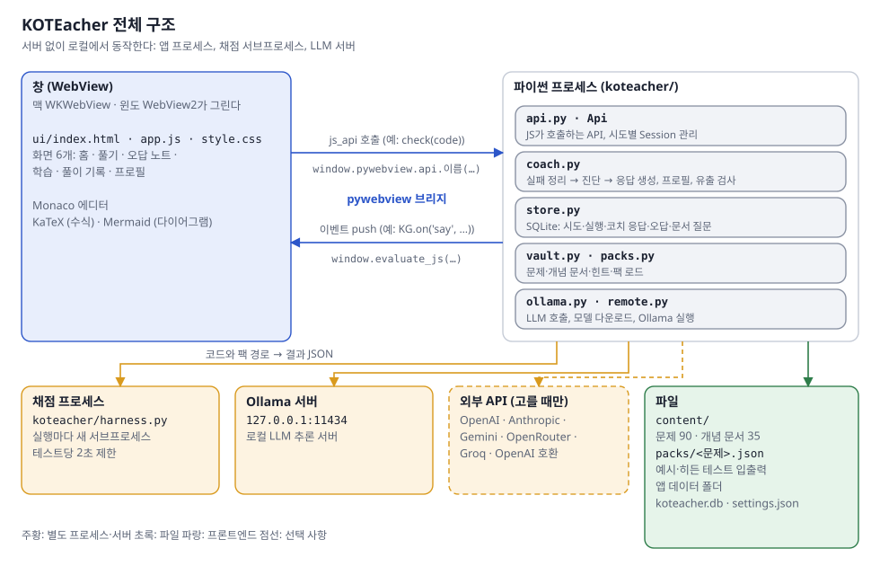
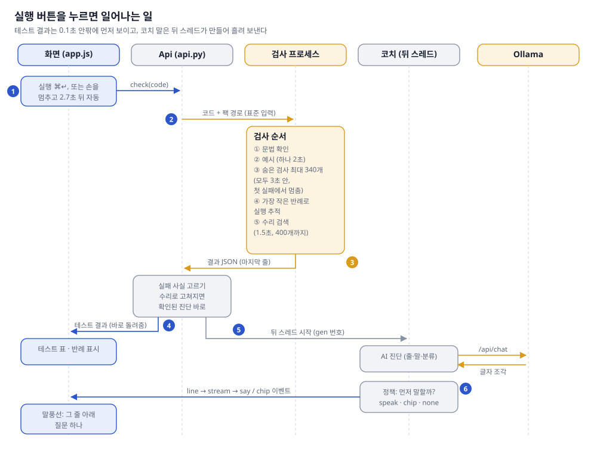
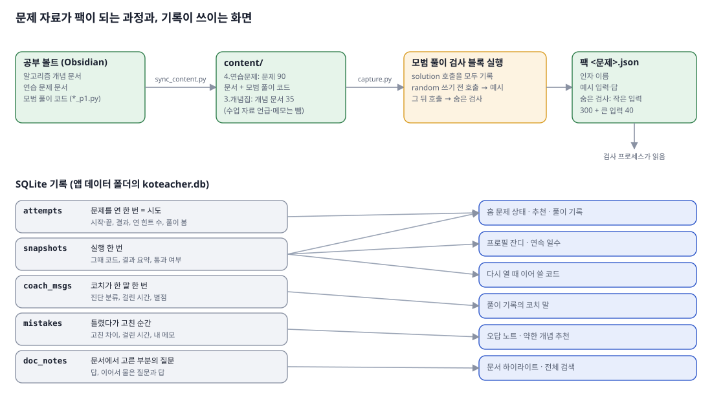
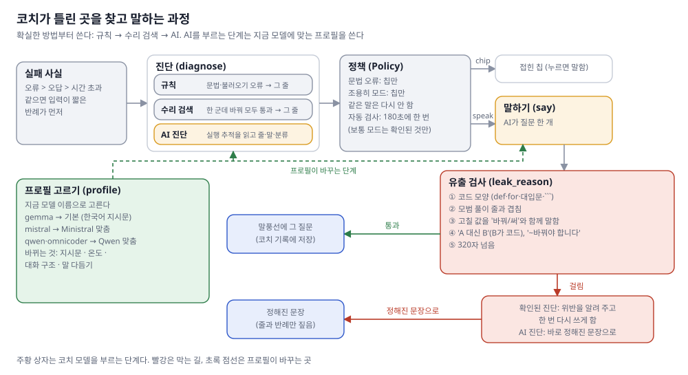
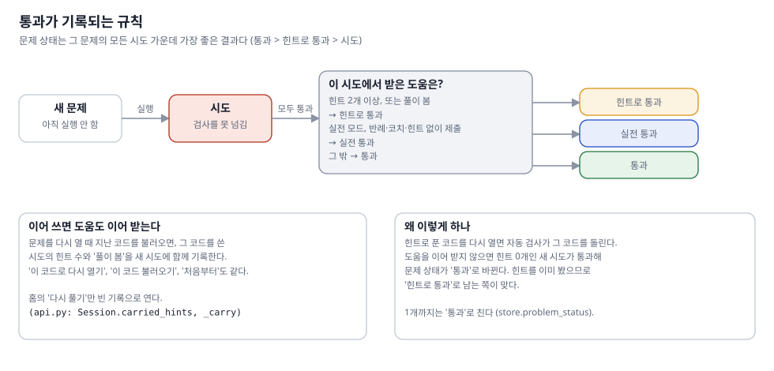
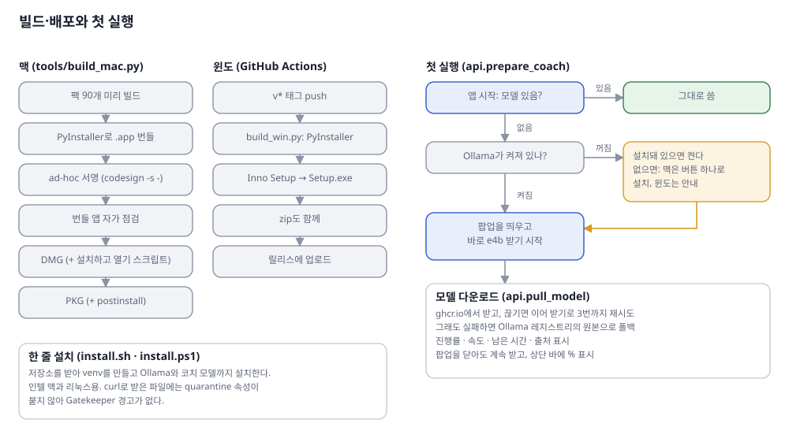

# KOTEacher 아키텍처

KOTEacher는 프로그래머스 문제 90개로 코딩 테스트를 연습하는 데스크톱 앱입니다. 학생이 코드를 실행하면 예시와 히든 테스트로 채점하고, 틀렸을 때는 로컬 LLM 코치가 문제가 있는 줄을 짚어 질문을 하나 던집니다. 정답은 알려 주지 않습니다.

이 문서는 파이썬을 읽을 줄 아는 개발자를 위한 문서입니다. 전체 구조를 먼저 보이고, 실행 한 번이 어떻게 흘러가는지 따라간 뒤, 채점·코치·기록·배포를 차례로 설명합니다. 측정 결과는 [품질 측정](#품질-측정)에, 파일별 역할은 맨 끝의 [코드 맵](#코드-맵)에 모았습니다. 예제 코드 한 편이 파이프라인을 지나며 앱 화면에 띄우는 것과 뒤에서 주고받는 JSON, LLM 메시지, 이벤트는 [예제로 따라가는 파이프라인](pipeline-walkthrough.md)에 따로 정리했습니다.

## 용어

이 프로젝트에서만 쓰는 이름입니다. 나머지는 일반적인 개발 용어 그대로 씁니다.

| 용어 | 뜻 |
|---|---|
| 팩 | 문제 하나의 예시와 히든 테스트 입출력을 담은 JSON 파일. 모범 풀이를 실행해 만든다 |
| 예시 | 문제 본문의 입출력 예. 학생 화면에 보이고 가장 먼저 돌린다 |
| 히든 테스트 | 학생에게 보이지 않는 채점용 입출력. 화면과 코치 프롬프트에서는 '숨은 검사'로 표시한다 |
| harness | 학생 코드를 채점하는 서브프로세스. 실행할 때마다 새로 띄운다 |
| 변이 탐색 | 비교 연산자, 정수 상수, 인덱스 같은 곳을 한 군데씩 바꿔 보며 모든 테스트를 통과시키는 수정을 찾는 결정적 진단 |
| 실행 추적 | 가장 작은 반례로 코드를 돌리며 줄마다 바뀐 지역 변수를 기록한 것. LLM 진단의 입력이 된다 |
| 코치 | 실패를 진단하고 질문을 만드는 기능 전체 |
| 프로필 | 모델 계열마다 다른 시스템 프롬프트, temperature, 메시지 구조, 후처리의 묶음 |
| 유출 검사 | 코치 응답에 정답 코드나 고칠 값이 들어 있는지 거르는 필터 |
| 폴백 템플릿 | LLM을 쓸 수 없거나 유출 검사에 걸렸을 때 대신 보여 주는 고정 문장 |
| 칩 | 코치가 바로 말하지 않을 때 에디터 줄 끝에 띄우는 작은 알림. 누르면 말풍선이 열린다 |

---

## 전체 구조



KOTEacher에는 서버가 없고, 사용자 컴퓨터에서 세 종류의 프로세스가 돕니다.

가장 큰 것은 앱 프로세스입니다. pywebview가 운영체제의 WebView를 띄워 HTML·JS로 짠 프론트엔드를 그리고, 같은 프로세스의 파이썬 백엔드가 채점·코치·기록을 맡습니다. WebView는 맥에서는 WKWebView, 윈도에서는 WebView2입니다.

학생 코드는 앱 프로세스 안에서 실행하지 않습니다. 무한 루프나 깊은 재귀, 메모리 폭주가 UI까지 멈추게 하면 안 되기 때문입니다. 그래서 실행할 때마다 harness 서브프로세스를 새로 띄우고, 결과는 JSON으로만 돌려받습니다. harness는 `python -I`로 띄웁니다. 격리 모드라서 학생 코드가 앱의 모듈을 import하지 못합니다. PyInstaller로 묶은 배포판에는 별도 파이썬 인터프리터가 없으므로, 앱 실행 파일 자신을 `--harness` 인자로 한 번 더 실행합니다.

코치의 LLM은 로컬 Ollama 서버가 돌립니다. 메모리가 부족한 사용자는 설정에서 OpenAI, Anthropic, Gemini 같은 외부 API로 바꿀 수 있습니다.

관련 코드: `koteacher/app.py`, `koteacher/runner.py`, `koteacher/config.py`의 `child_cmd`, `koteacher_main.py`

## 프론트엔드와 백엔드의 통신

통신은 방향에 따라 두 가지입니다.

JS에서 파이썬을 부를 때는 pywebview의 `js_api`를 씁니다. 창을 만들 때 `Api` 객체를 넘겨 두면, JS에서 `window.pywebview.api.check(code, "run")`처럼 메서드를 호출할 수 있습니다. 반환값은 JSON으로 직렬화되어 Promise로 돌아옵니다. `Api`의 공개 메서드 50개가 프론트엔드가 쓸 수 있는 API 전부입니다.

반대로 파이썬에서 JS로 알릴 때는 이벤트를 push합니다. 코치 응답이나 모델 다운로드처럼 몇 초 넘게 걸리는 작업은 백그라운드 스레드에서 처리하고, 진행 상황이 생길 때마다 `Api._push(event, data)`가 `evaluate_js("KG.on(이름, 데이터)")`를 호출합니다. 프론트엔드의 `KG.on`은 이벤트 이름에 따라 핸들러로 나눠 처리합니다.

| 이벤트 | 보내는 시점 | 프론트엔드 동작 |
|---|---|---|
| `thinking` | 코치가 LLM 호출을 시작할 때 | 대기 표시 |
| `line` | LLM이 줄 번호를 먼저 출력했을 때 | 말풍선을 미리 그 줄 아래에 배치 |
| `stream` | 토큰이 도착할 때마다 | 말풍선에 이어 쓰기 |
| `diag` | LLM 진단이 끝났을 때 | 진단 분류와 줄 갱신 |
| `say`, `chip` | 응답이 확정됐을 때 | 말풍선 확정 또는 칩 표시 |
| `answer` | 학생이 직접 한 질문의 답이 끝났을 때 | 그 질문의 말풍선에 답 표시 |
| `coach_error` | 코치가 실패했을 때 | 실패 안내. 테스트 결과는 그대로 둔다 |
| `prep`, `pull`, `pull_done`, `model_ready` | 첫 실행 준비와 모델 다운로드 | 진행률 표시 |
| `doc_stream`, `doc_answer` | 개념 문서 질문에 답할 때 | 문서 옆 답 상자에 표시 |

코치 응답은 몇 초씩 걸리기 때문에, 그 사이에 학생이 코드를 고쳐 다시 실행하는 일이 흔합니다. 이전 실행의 응답이 늦게 도착하면 이미 고친 줄을 짚게 되므로, 실행할 때마다 세대 번호 `gen`을 올리고 응답 이벤트에 붙입니다. 백엔드는 응답이 현재 `gen`과 다르면 보내지 않습니다. 학생이 직접 한 질문은 사정이 다릅니다. 답을 기다리는 동안 자동 채점이 한 번 돌았다고 답을 버리면 질문이 영영 끝나지 않으므로, 질문마다 프론트엔드가 만든 ID `rid`로 답의 자리를 찾고 `gen`과 상관없이 전달합니다.

관련 코드: `koteacher/api.py`의 `_push`, `_current`, `ui/app.js`의 `handlers`

## 실행 한 번의 흐름



학생이 실행 버튼을 누르거나 입력을 멈춘 지 2.7초가 지나면, 프론트엔드가 `check(code, trigger)`를 호출합니다. 자동 실행은 코드가 마지막 실행 때와 달라졌을 때만 일어나고, 코치를 조용히 모드로 두면 아예 꺼집니다.

`Api.check`는 `gen`을 올린 뒤 harness를 띄워 코드와 팩 경로를 stdin으로 넘깁니다. harness는 채점이 끝나면 결과 JSON을 stdout의 마지막 줄에 씁니다. 학생 코드의 `print` 출력이 앞쪽에 섞여 나오므로, 백엔드는 `{`로 시작하는 마지막 줄만 읽습니다.

결과를 받으면 실패를 정리하고, 변이 탐색이 수정을 찾았으면 그 자리에서 진단을 확정합니다. 테스트 결과는 코치를 기다리지 않고 바로 프론트엔드로 돌려보내므로, 학생은 테스트 표와 반례를 곧바로 봅니다. 변이 탐색으로 해결되지 않은 실패는 백그라운드 스레드가 LLM에 맡기고, 생성되는 토큰을 `stream` 이벤트로 흘려보냅니다. 마지막으로 발화 정책이 바로 말할지 칩으로 미룰지 정합니다.

버그 두 개짜리 코드, 한 개짜리 코드, 고친 코드가 이 흐름을 각각 어떻게 지나가는지는 [예제로 따라가는 파이프라인](pipeline-walkthrough.md)에서 실제 앱 화면과 그때 돈 단계별 데이터로 볼 수 있습니다.

몇 가지 경우는 이 흐름을 일찍 끝냅니다.

- 모든 테스트를 통과하면 시도를 통과로 기록하고, 직전에 실패한 기록이 있으면 오답 기록을 남깁니다.
- 문법 오류나 import 오류는 그 줄에 칩만 띄우고 LLM을 부르지 않습니다.
- `solution` 본문이 두 문장 이하인 템플릿 상태라면 코치는 기다립니다.
- 변이 탐색으로 확정된 진단을 바로 말하기로 했다면, 먼저 폴백 템플릿을 보여 주고 LLM 문장이 준비되면 바꿔 끼웁니다.

## 채점: harness

harness는 `koteacher` 패키지를 import하지 않는 독립 파일이며, 아래 순서로 채점합니다.

1. `ast.parse`로 문법을 확인합니다. 오류가 있으면 줄과 칸, 메시지만 내고 끝납니다.
2. 코드를 `exec`해 `solution`을 꺼냅니다. 함수가 없거나 모듈 수준 코드에서 예외가 나면 그 줄을 내고 끝납니다.
3. 예시를 돌립니다.
4. 히든 테스트를 입력 크기 순으로 돌리다가 처음 실패한 곳에서 멈춥니다. 그 입력이 학생에게 보여 줄 반례가 됩니다.
5. 실패가 있으면 실행 추적을 만들고 변이 탐색을 돌립니다.

출력 비교는 프로그래머스 채점과 맞추기 위해 튜플과 리스트를 같게 보고, 실수는 소수점 아래 9자리로 반올림해 비교합니다.

### 시간 제한

| 상수 | 값 | 의미 |
|---|---|---|
| `PER_TEST` | 2초 | 테스트 하나의 제한. 넘으면 시간 초과로 기록하고 남은 테스트를 돌리지 않는다 |
| `HIDDEN_BUDGET` | 3초 | 히든 테스트 전체의 제한. 다 돌지 못하면 통과로 치지 않는다 |
| `SUBMIT_BUDGET` | 12초 | 실전 모드 제출의 제한. 제출은 실패해도 끝까지 돌리되, 12초가 지나거나 시간 초과가 두 번 나면 멈춘다 |
| `REPAIR_BUDGET` | 1.5초 | 변이 탐색 전체의 제한 |
| `REPAIR_PER_TEST` | 0.2초 | 변이 탐색 중 테스트 하나의 제한 |
| `runner.check(timeout=)` | 20초 | harness 프로세스 전체의 제한. 넘으면 프로세스를 강제로 끝낸다 |
| `MAX_OUT` | 4,000자 | 학생 코드 `print` 출력을 보여 주는 길이 |

시간 제한은 `Deadline` 컨텍스트 매니저가 겁니다. `threading.Timer`가 제한 시간 뒤에 `_thread.interrupt_main()`을 호출하면 메인 스레드에 `KeyboardInterrupt`가 발생하고, 이를 잡아 시간 초과로 기록합니다. `KeyboardInterrupt`는 `Exception`의 하위 클래스가 아니어서 학생 코드의 `except Exception:`에 걸리지 않습니다. 윈도에는 `signal.alarm`이 없으므로 세 운영체제에서 똑같이 동작하도록 이 방식을 골랐습니다. 또 테스트 340개를 한 프로세스에서 이어 돌리기 때문에 테스트마다 프로세스를 띄우는 비용이 들지 않습니다.

다만 이 방식은 인터럽트가 바이트코드 사이에서만 처리된다는 한계가 있습니다. 큰 리스트의 `sorted`처럼 C 함수 하나가 오래 돌면 그 함수가 끝날 때까지 끊지 못하고, 학생 코드에 맨 `except:`가 있으면 예외를 삼켜 버릴 수도 있습니다. 이런 경우는 runner의 20초 제한이 프로세스째 끝내는 것으로 막습니다.

### 실행 추적

LLM이 원인 줄을 찾으려면 반례에서 값이 어떻게 변했는지가 필요합니다. 그래서 실패한 입력 중 `repr`이 가장 짧은 것을 골라, 그 길이가 300자 이하이면 `sys.settrace`로 다시 실행하며 줄마다 바뀐 지역 변수를 기록합니다. 기록은 40줄, 0.5초까지만 하고 값은 40자에서 자릅니다. LLM에는 이 중 앞 16줄을 `L5 i=0 total=1` 같은 압축 형식으로 넘겨 프롬프트를 짧게 유지합니다.

### 변이 탐색

경계 조건 실수는 대개 한 글자 차이입니다. `<`를 `<=`로 써야 했거나 `n` 대신 `n - 1`이어야 하는 식입니다. 이런 실수는 LLM 없이도 찾을 수 있으므로, harness가 먼저 코드를 한 군데씩 바꿔 보며 모든 테스트를 통과시키는 수정이 있는지 찾습니다.

`mutation_sites`가 AST를 훑어 바꿔 볼 자리를 모으고, 자리마다 `apply_mutation`으로 한 곳만 바꾼 코드를 만듭니다. 바꾼 코드는 실패했던 입력부터 돌려 보고, 그걸 다 통과하면 예시와 히든 테스트 앞 120개를 0.6초 안에 돌립니다. 이것까지 통과하면 수정 후보로 기록합니다. 탐색은 1.5초가 지나거나, 변이 400개를 시도했거나, 수정을 3개 찾으면 멈춥니다.

| 변이 | 예 | 실수 분류 |
|---|---|---|
| 비교 연산자 교체 | `<` ↔ `<=`, `>` ↔ `>=`, `==` ↔ `!=` | 비교·경계 |
| 정수 상수 ±1 (인덱스 안 상수 제외) | `0` → `1` | 비교·경계 |
| `and` ↔ `or` | | 조건 놓침 |
| `+` ↔ `-` | `i + 1` → `i - 1` | 기타 |
| `min` ↔ `max` | | 기타 |
| `range` 인자 ±1 (상수 인자 제외) | `range(n - 1)` → `range(n)` | 인덱스 |
| 인덱스 ±1 (슬라이스·상수 인덱스 제외) | `a[i]` → `a[i + 1]` | 인덱스 |

한 번에 한 곳만 바꾸므로 버그가 두 군데 있으면 수정을 찾지 못하고, 그 경우는 LLM 진단으로 넘어갑니다. 또 찾은 수정이 테스트는 통과해도 학생이 의도한 고침과 다를 수 있기 때문에, 코치는 수정 내용을 말하지 않고 그 줄만 짚습니다.

관련 코드: `koteacher/harness.py`

## 문제 데이터와 팩



문제 문서, 모범 풀이, 개념 문서는 개발자의 Obsidian 노트에서 가져옵니다. `tools/sync_content.py`가 이 파일들을 `content/`로 복사하면서, 공개 저장소에 둘 수 없는 수업 자료 언급과 개인 메모를 걸러 냅니다. 그 결과가 문제 90개와 개념 문서 35개입니다.

히든 테스트는 따로 작성하지 않고, 모범 풀이 파일의 `__main__` 블록에서 뽑아냅니다. 이 블록에는 원래 모범 풀이를 검증하려고 예시 입력과 무작위 입력으로 `solution`을 호출하는 코드가 들어 있습니다. `capture.py`가 이 블록을 실행하면서 `solution` 호출을 가로채 입력과 출력을 기록합니다. `random`을 처음 쓰기 전의 호출 중 인자가 모두 리터럴로 적힌 것은 예시가 되고, 나머지는 히든 테스트가 됩니다.

`packs.py`는 히든 테스트를 입력 크기 순으로 정렬한 뒤, 가장 작은 입력 300개와 나머지에서 무작위로 고른 40개를 팩에 넣습니다. 작은 입력을 앞에 두는 이유는 첫 실패에서 채점을 멈추기 때문입니다. 그렇게 하면 학생이 받는 반례가 대개 가장 작은 입력이 되어 손으로 따라가기 쉽습니다. 큰 입력 40개는 느린 풀이를 걸러 내는 역할을 하고, 무작위 시드를 고정해 두어 팩을 다시 만들어도 같은 입력이 나옵니다.

맥 앱은 팩 90개를 번들에 넣어 배포하고, 소스로 설치한 경우에는 첫 실행 때 앱 데이터 폴더에 팩을 만듭니다.

관련 코드: `tools/sync_content.py`, `koteacher/capture.py`, `koteacher/packs.py`

## 코치



코치는 실패를 정리하고, 원인 줄을 진단하고, 학생에게 할 질문을 만들어 유출 검사를 거친 뒤 보여 줍니다. 진단은 결정적인 방법부터 시도하고, 그래도 안 될 때만 LLM을 씁니다.

### 실패 정리와 3단계 진단

`coach.facts`는 채점 결과에서 실패를 모아 예외, 오답, 시간 초과 순으로 정렬하고, 같은 종류끼리는 입력이 짧은 것을 앞에 둡니다. 코치는 맨 앞의 실패 하나만 다룹니다.

| 단계 | 쓰는 경우 | 짚는 줄 | 확신도 |
|---|---|---|---|
| 규칙 | 문법 오류, import 오류 | 오류가 난 줄 | 확정 |
| 변이 탐색 | 한 곳 수정으로 모든 테스트 통과 | 첫 수정 후보의 줄 | 확정 |
| LLM | 그 밖의 경우 | 모델이 고른 줄 | 추정 |

LLM 호출이 실패하면 규칙 단계로 돌아가, 예외는 예외가 난 줄을 짚고 오답은 줄 없이 반례만 보여 줍니다. 진단 결과에는 아홉 가지 실수 분류 중 하나가 붙는데, 이 분류는 오답 노트와 추천에도 쓰입니다.

### LLM 진단

LLM에는 메시지 네 개를 보냅니다. 첫째는 정답 코드를 말하지 말고 증거에 없는 버그를 지어내지 말며 질문 하나로 답하라는 시스템 프롬프트입니다. 둘째는 문제 앞부분과 줄 번호를 붙인 학생 코드입니다. 셋째는 미리 채워 둔 assistant 응답이고, 넷째가 이번 실패의 증거와 할 일입니다. 증거에는 실패 위치, 입력, 기대 출력과 실제 출력, 실행 추적, 학생이 연 힌트, 자주 틀리는 실수 분류, 코치가 이미 한 말이 들어갑니다.

응답은 JSON이 아니라 이름표가 붙은 세 줄로 받습니다.

```text
줄: 6
말: 6번 줄에서 i가 마지막 값일 때 arr[i + 1]은 어디를 가리킬까요? 반례 [3]으로 따라가 보세요.
분류: 인덱스
```

JSON의 괄호와 따옴표를 생성하지 않아도 되니 응답이 약 13% 빨리 끝납니다. 또 스트리밍 중에 `줄:` 값을 읽자마자 `line` 이벤트를 보낼 수 있어서, 말풍선이 처음부터 올바른 줄 아래에 뜹니다. 받은 줄 번호가 코드 범위를 벗어나면 버립니다.

### 프롬프트 캐싱

M3 맥에서 로컬 모델은 프롬프트를 초당 100토큰 안팎으로 읽기 때문에, 매번 문제와 코드를 처음부터 읽으면 첫 토큰까지 몇 초가 걸립니다. 다행히 Ollama는 앞부분이 같은 프롬프트의 KV 캐시를 재사용하므로, 모든 호출이 시스템 프롬프트, 문제와 코드, 고정 assistant 응답의 세 메시지로 똑같이 시작하게 만들고 매번 바뀌는 증거는 맨 뒤에 둡니다. 문제를 열 때는 `coach.warm`이 앞의 두 메시지만 보내 캐시를 미리 채워 둡니다. 코드 주석의 측정에 따르면 캐시가 맞을 때 읽는 시간이 10초에서 1초 안팎으로 줄어듭니다. 외부 API에서는 요청마다 비용이 들기 때문에 `warm`을 보내지 않습니다.

### 발화 정책

코치가 매번 말을 걸면 학생의 흐름을 끊습니다. 그래서 `Policy.decide`가 아래 규칙을 순서대로 보고 바로 말할지 칩으로 미룰지 정합니다.

1. 문법 오류는 칩만 띄웁니다.
2. 조용히 모드에서는 칩만 띄웁니다.
3. 같은 실수 분류, 같은 줄, 같은 반례로 이미 말했다면 칩만 띄웁니다.
4. 자동 실행에서는 마지막으로 먼저 말한 지 180초가 지나야 다시 말하고, 보통 모드에서는 변이 탐색으로 확정된 진단만 먼저 말합니다.
5. 그 밖에는 말합니다.

결과적으로 학생이 직접 실행할 때는 대부분 바로 답하고, 손을 멈출 때마다 도는 자동 실행에서는 3분에 한 번 정도, 확실한 실수만 먼저 짚게 됩니다. 또 학생이 코치와 대화하는 중에는 새 코치 응답이 그 말풍선을 덮지 않고 줄 끝 칩으로 기다립니다.

### 유출 검사와 폴백

LLM은 지시를 해도 가끔 고칠 코드를 그대로 말해 버립니다. 그래서 응답을 보여 주기 전에 `coach.leak_reason`이 정규식과 문자열 비교로 검사합니다.

| 거르는 경우 | 예 |
|---|---|
| 빈 응답, 320자 초과 | |
| 코드 블록, 줄 머리의 `def`·`for`·`while`·`if`·`return`, `x[...] =` 대입 | "for i in range(n):를 보세요" |
| 'A 대신 B'에서 B가 기호를 포함한 짧은 코드 | "j 대신 j + 1을 써 보세요" |
| 물음표로 끝나지 않는 문장의 '바꿔야 합니다', '쓰면 됩니다' | "초기값을 바꿔야 할 것 같습니다." |
| 모범 풀이의 18자 이상 줄과 겹침 | |
| 변이 탐색이 찾은 수정값 뒤에 '로 바꾸', '를 써'가 옴 | "<=로 바꾸면 돼요" |

검사에 걸렸을 때의 처리는 진단 단계에 따라 다릅니다. 변이 탐색으로 확정된 진단은 응답을 따로 생성하므로, 위반 사유를 붙여 한 번 다시 생성하게 하고 그래도 걸리면 폴백 템플릿을 씁니다. LLM 진단은 진단과 응답을 한 번에 받기 때문에 바로 폴백 템플릿으로 바꿉니다. 폴백 템플릿은 실패 종류와 실수 분류에 맞춰 줄 번호와 반례만 채워 넣은 문장입니다.

정규식 기반이라 "등호를 하나 더 붙여 보세요"처럼 말로 바꿔 표현한 유출은 잡지 못합니다. 지금까지 잰 것은 검사가 잡은 개수뿐이고, 놓친 비율은 아직 측정하지 않았습니다.

### 모델별 프로필

시스템 프롬프트는 기본 모델인 gemma4 e4b의 응답을 보며 다듬었습니다. 다른 모델은 이름표를 빼먹거나, 질문 대신 원인을 단정하거나, 마크다운을 섞는 식으로 버릇이 달라서, 모델 계열마다 프로필을 따로 둡니다.

| 프로필 | 선택 조건 | 프롬프트 특징 | temperature (진단/응답/질문) | 메시지 구조 | 후처리 |
|---|---|---|---|---|---|
| `gemma` | 기본 | 짧은 한국어 규칙 | 0.3 / 0.5 / 0.4 | 4개로 나눔 | 없음 |
| `mistral` | 모델 이름에 `mistral` | 앱과 코치의 역할을 먼저 밝히고 질문 하나·80자 이내로 제한 | 0.05 / 0.05 / 0.05 | 4개로 나눔 | 마크다운 제거, 첫 질문 뒤 자르기 |
| `qwen` | 이름에 `qwen`이나 `omnicoder` | 출력 예시 하나로 형식 고정 | 0.7 / 0.7 / 0.7 | 하나로 합침 | 없음 |

프로필은 지금 쓰는 모델 이름으로 자동 선택하고, 환경 변수 `KOTEACHER_PROMPT`로 강제할 수 있습니다. Ministral의 0.05는 모델 카드의 권장값인 0.1 미만을, Qwen의 0.7은 Qwen 권장값을 따랐습니다. Qwen 프로필은 이름표를 빼먹는 버릇을 줄이려고 출력 예시로 형식을 고정하고, 미리 채운 assistant 응답 없이 메시지를 하나로 합쳐 보냅니다. 그 대신 프롬프트 캐싱의 이득은 줄어듭니다.

관련 코드: `koteacher/coach.py`, `koteacher/ollama.py`, `koteacher/remote.py`

## 기록: SQLite

기록은 앱 데이터 폴더의 `koteacher.db`에 저장합니다. 테이블은 다섯 개입니다.

| 테이블 | row 하나 | 주요 컬럼 | 쓰는 화면 |
|---|---|---|---|
| `attempts` | 문제를 한 번 연 시도 | 모드, 시작·종료 시각, 결과, 연 힌트 수, 풀이 열람 여부 | 문제 상태, 추천, 풀이 기록 |
| `snapshots` | 실행 한 번 | 코드, 결과 요약, 통과 여부 | 이어 쓸 코드, 프로필 잔디 |
| `coach_msgs` | 코치 응답 하나 | 진단 단계, 줄, 응답 시간, 평가 | 풀이 기록의 코치 응답 |
| `mistakes` | 고친 실수 하나 | 실수 분류, 수정 전후 코드와 diff, 걸린 시간, 메모 | 오답 노트, 약한 분류 추천 |
| `doc_notes` | 문서 질문 하나 | 고른 문장, 질문, 답, 이어서 묻기 | 문서 하이라이트, 전체 검색 |



문제 상태는 그 문제의 모든 시도 중 가장 좋은 결과로 정합니다. 통과한 시도에서 힌트를 두 개 이상 열었거나 풀이를 봤다면 '힌트로 통과'이고, 실전 모드에서 연습 채점 없이 힌트 0개로 제출해 통과했다면 '실전 통과'로 따로 셉니다.

여기서 한 가지 함정이 있었습니다. 힌트를 보고 푼 코드를 다시 열면 자동 채점이 그 코드를 돌리는데, 새 시도에는 힌트 기록이 없으니 '통과'로 바뀌어 버립니다. 그래서 지난 시도의 코드를 이어 쓰는 경우에는 그 시도의 힌트 수와 풀이 열람 여부도 새 시도로 넘깁니다. 마지막 코드를 불러오며 다시 열 때, 풀이 기록에서 코드를 불러올 때, '처음부터'를 누를 때가 여기에 해당하고, 홈 추천의 '다시 풀기'만 빈 기록으로 시작합니다.

오답 기록은 진단이 생긴 실패를 `Session.open_fail`로 들고 있다가, 학생이 통과하면 수정 diff와 걸린 시간을 함께 저장하는 방식입니다. 코치는 여기서 가장 많이 나온 실수 분류 세 개를 증거에 넣어, 학생이 자주 틀리는 쪽을 먼저 의심하게 합니다.

관련 코드: `koteacher/store.py`, `koteacher/api.py`의 `_carry`, `_record_mistake`

## 실전 모드

실전 모드는 실제 시험처럼 풀어 보는 모드라서, 자동 채점과 코치, 힌트, 반례를 모두 끄고 예시 실행과 제출만 남깁니다. 제출은 히든 테스트를 끝까지 돌려 통과 개수만 알려 주고, 실행 추적과 변이 탐색은 하지 않습니다. 같은 시도에서 연습 채점을 한 번이라도 돌렸거나 제한 시간이 지난 뒤 통과했다면 실전 통과로 치지 않습니다.

관련 코드: `koteacher/api.py`의 `exam_run`, `ui/app.js`의 `setExam`

## 빌드, 배포, 첫 실행



맥 빌드는 `tools/build_mac.py`가 맡습니다. 팩을 만들고 PyInstaller로 `.app`을 묶은 뒤 ad-hoc 서명을 하고, 번들 앱에 `--harness`와 `--run`으로 시험 코드를 넣어 채점과 개념 코드 실행이 되는지 확인한 다음 DMG와 PKG를 만듭니다.

배포 파일이 둘인 이유는 Gatekeeper 때문입니다. 이 앱은 Apple 공증을 받지 않았으므로, 브라우저로 받은 파일에는 quarantine 속성이 붙고 처음 열 때 차단됩니다. 특히 ad-hoc 서명된 앱은 '손상되었기 때문에 열 수 없습니다'로 표시되어 '그래도 열기' 버튼도 나오지 않습니다.

- **PKG**: 설치 프로그램이 설치한 파일에는 quarantine 속성이 붙지 않습니다. 그래서 PKG 자체를 한 번 허용하고 나면 앱은 경고 없이 열립니다. 다만 `pkgbuild`가 한글 NFC 파일 이름을 담지 못하기 때문에, 번들 안의 한글 이름을 NFD로 바꿔 담고 postinstall 스크립트가 설치 후 다시 NFC로 되돌립니다. 앱은 NFC 이름끼리 비교하므로 이 복원이 필요합니다. `BundleIsRelocatable`도 꺼서, 다른 위치에 같은 앱이 있어도 항상 `/Applications`에 설치되게 했습니다.
- **DMG**: 'KOTEacher 설치하고 열기' 스크립트가 들어 있습니다. 이 스크립트가 앱을 `/Applications`로 복사하고 quarantine 속성을 지운 뒤 앱을 엽니다. 스크립트 자체도 서명이 없어서 처음에는 차단되지만, 서명이 아예 없는 스크립트는 시스템 설정에서 '그래도 열기'로 허용할 수 있습니다.

윈도 빌드는 `v*` 태그를 push하면 GitHub Actions가 `build_win.py`로 PyInstaller 빌드를 하고, Inno Setup으로 `Setup.exe`를 만들어 zip과 함께 릴리스에 올립니다. 인텔 맥과 리눅스에서는 `install.sh`로 소스를 받아 venv에 설치합니다. 이렇게 curl로 받은 파일에는 quarantine 속성이 붙지 않으므로 Gatekeeper 경고도 없습니다.

첫 실행 때 `Api.prepare_coach`는 코치를 쓸 수 있는 상태인지 확인하고, 모자란 것을 순서대로 채웁니다. Ollama 서버가 꺼져 있으면 켜고, 설치되어 있지 않으면 맥에서는 버튼 하나로 설치까지 하며, 모델이 없으면 팝업을 띄우고 기본 모델 다운로드를 시작합니다.

기본 모델은 ghcr.io에 올려 둔 gemma4 e4b 텍스트 전용판입니다. 원본에서 비전 인코더를 빼서 1GB가량 작습니다. 다운로드가 끊기면 이어 받기로 세 번까지 다시 시도하고, 그래도 실패하면 Ollama 레지스트리의 원본 `gemma4:e4b-it-qat`로 폴백합니다. 진행률은 Ollama가 레이어별로 보내는 진행을 합산하고, 최근 8초 동안 늘어난 양으로 속도와 남은 시간을 계산합니다.

관련 코드: `tools/build_mac.py`, `tools/build_win.py`, `.github/workflows/build.yml`, `install.sh`, `koteacher/api.py`의 `prepare_coach`, `pull_model`

## 품질 측정

학생 코드를 모을 수 없으므로, 모범 풀이에 버그를 주입해 테스트용 학생 코드를 만들고 코치를 돌려 봅니다. `eval/bugs.py`가 변이 탐색과 같은 변이 연산자로 모범 풀이를 한 곳 또는 두 곳 바꾸고, 실제로 채점에서 떨어지는 것만 남깁니다. 이렇게 버그 하나짜리 258개와 버그 두 개짜리 81개를 만들었습니다.

**변이 탐색.** 버그 하나짜리 258개 중 243개를 변이 탐색이 고쳤고, 그중 236개에서 짚은 줄이 실제 버그 줄이었습니다. 예외나 시간 초과로 규칙 단계가 짚은 11개까지 합치면 줄 적중률은 95.7%입니다. 채점과 변이 탐색을 합친 시간의 중앙값은 76ms였습니다. 다만 버그를 만든 연산자와 탐색하는 연산자가 같으므로 이 수치는 낙관적입니다. 실제 학생 실수는 이 범위 밖에 있을 수 있고, 실제 학생 코드로는 아직 재지 않았습니다.

**LLM 진단.** 버그 두 개짜리 중 12문제로 모델을 비교했습니다. 이전 측정에서 틀린 문제를 모두 넣고 맞힌 문제 5개를 더한 묶음이라, 전체 81문제보다 어렵습니다. 진단한 줄이 두 버그 줄 중 하나면 적중으로 셉니다.

| 모델 · 프로필 | 줄 적중 | 응답 완료 중앙값 | 첫 토큰 | 질문으로 끝남 | 유출 |
|---|---|---|---|---|---|
| gemma4 e4b · `gemma` | 9/12 | 4.6초 | 3.2초 | 17/21 | 0/22 |
| Ministral 3 8B · `mistral` | 7/12 | 14.2초 | 9.1초 | 19/21 | 0/22 |

한 문제가 8.3%포인트라서 줄 적중의 차이는 두 문제에 불과하고, 12문제로는 어느 쪽이 낫다고 단정할 수 없습니다. 반면 응답 시간은 12문제 모두에서 Ministral이 2.5~3.4배 느렸습니다. 이 결과 때문에 기본 모델은 e4b로 두고 Ministral은 선택지로만 제공합니다. 측정 환경은 MacBook Air M3, 메모리 16GB입니다.

측정 스크립트는 det·llm·say 세 모드를 가진 `eval/run_eval.py`와 모델 비교용 `eval/compare_models.py`이고, 결과는 `eval/results/`에 있습니다.

## 외부 의존성

| 이름 | 종류 | 용도 | 비고 |
|---|---|---|---|
| Ollama | 로컬 LLM 서버, MIT | 코치 모델 추론, 모델 다운로드 | 모델이 메모리 5~7GB를 차지한다 |
| gemma4 e4b 텍스트 전용판 | 모델, Apache 2.0 | 기본 코치 | ghcr.io에서 배포. 원본이 업데이트돼도 자동으로 따라가지 않는다 |
| Ministral 3 8B | 모델 | 선택 코치 | Hugging Face 공식 GGUF. 라이선스는 공식 모델 카드에서 확인 필요 |
| gemma4 12B | 모델 | '정확도 우선' 선택지 | 같은 12문제에서 e4b보다 적중률이 높지 않았다(6/12) |
| 외부 API | 서비스 | 선택 코치 | OpenAI, Anthropic, Gemini, OpenRouter, Groq, OpenAI 호환 서버. 코드가 외부로 나간다 |
| pywebview | 라이브러리, BSD | 창과 JS 브리지 | 윈도는 WebView2 런타임이 필요하다 |
| Monaco | 라이브러리, MIT | 코드 에디터 | `ui/vendor/` 9.1MB 중 6.0MB를 차지한다 |
| KaTeX, Mermaid | 라이브러리, MIT | 문서의 수식과 다이어그램 | 오프라인에서도 동작하도록 `ui/vendor/`에 포함 |
| pyflakes | 라이브러리, MIT | 타이핑 중 정적 분석 | 실행하지 않고 읽기만 하므로 앱 프로세스에서 돌린다 |
| PyInstaller | 빌드 도구 | 맥 `.app`, 윈도 `.exe` | 학생 코드가 import할 표준 모듈을 명시해 함께 묶는다 |
| Inno Setup | 빌드 도구 | 윈도 설치 파일 | 코드 서명이 없어 'PC 보호' 경고가 뜬다 |
| GitHub Actions, ghcr.io | 서비스 | 윈도 빌드, 모델 배포 | |

## 알려진 한계

- 윈도와 리눅스는 실제 기기에서 써 보지 않았습니다. 윈도 빌드는 Actions에서 빌드와 자가 점검까지만 확인합니다.
- 인텔 맥용 DMG와 PKG가 없어서, 인텔 맥은 `install.sh`를 써야 합니다.
- Apple 공증을 받지 않아서 처음 한 번은 '그래도 열기'가 필요합니다. 경고를 없애려면 Developer ID 서명과 공증이 필요합니다.
- LLM 진단의 줄 적중은 어려운 12문제 기준 75%이고, 81문제 전체로는 아직 재지 않았습니다.
- 유출 검사가 정규식이라 말로 바꿔 표현한 유출을 놓칠 수 있습니다.
- C 함수 안에서 오래 도는 코드는 2초에 끊지 못하고 20초 뒤 프로세스째 종료됩니다.
- OmniCoder-9B는 `qwen` 프로필에 연결만 해 두었고 측정하지 않았습니다.

## 코드 맵

| 파일 | 줄 수 | 역할 |
|---|---|---|
| `koteacher_main.py` | 41 | 번들 앱의 진입점. `--harness`, `--capture`, `--run` 인자를 처리하고 아니면 창을 띄운다 |
| `koteacher/__init__.py` | 2 | 버전 번호 |
| `koteacher/app.py` | 76 | 창 생성, 모델 미리 로드, 종료 시 언로드 |
| `koteacher/api.py` | 1,064 | `js_api`로 노출하는 API 50개, 시도별 `Session`, 이벤트 push, 채점·코치·힌트·실전·다운로드 흐름 |
| `koteacher/harness.py` | 353 | 채점 서브프로세스: 시간 제한, 예시·히든 테스트, 실행 추적, 변이 탐색 |
| `koteacher/runner.py` | 23 | harness를 띄우고 결과 JSON을 읽는다 |
| `koteacher/coach.py` | 741 | 실패 정리, 3단계 진단, 응답 생성, 유출 검사, 폴백 템플릿, 발화 정책, 프로필 |
| `koteacher/ollama.py` | 282 | Ollama 호출, 모델 다운로드와 속도 계산, Ollama 탐색·실행·설치, 기본 모델 추천 |
| `koteacher/remote.py` | 172 | 외부 API 호출 (OpenAI·Anthropic 형식) |
| `koteacher/store.py` | 190 | SQLite 테이블, 문제 상태, 프로필 집계 |
| `koteacher/vault.py` | 207 | 문제·개념 문서 로드, 힌트 사다리 |
| `koteacher/render.py` | 143 | Obsidian 마크다운을 화면용 HTML로 변환 |
| `koteacher/examples.py` | 144 | '예제 코드' 질문을 네 가지로 분류해 답하고 정답과 겹치는지 검사 |
| `koteacher/packs.py` | 69 | 팩 생성과 히든 테스트 선택 |
| `koteacher/capture.py` | 104 | 모범 풀이의 `solution` 호출 기록 |
| `koteacher/config.py` | 162 | 경로, 모델 선택지, 외부 API 목록, 설정 파일 |
| `koteacher/lint.py` | 58 | 타이핑 중 pyflakes 검사 |
| `ui/app.js` | 2,003 | 프론트엔드 전체: 홈, 풀기, 오답 노트, 학습, 풀이 기록, 프로필, 이벤트 처리 |
| `ui/index.html`, `style.css`, `doc.css` | 201, 511, 127 | 화면 구조와 스타일 |
| `tools/build_mac.py` | 205 | 맥 `.app`, DMG, PKG 빌드 |
| `tools/build_win.py`, `KOTEacher.iss` | 89, 34 | 윈도 빌드와 설치 파일 |
| `tools/build_packs.py`, `make_app.py`, `devserve.py` | 21, 37, 69 | 팩 빌드, 소스 설치용 앱 아이콘, 브라우저 개발 서버 |
| `tools/sync_content.py`, `push_ghcr.py` | 137, 136 | 콘텐츠 동기화, 모델을 ghcr.io에 업로드 |
| `install.sh`, `install.ps1` | 122, 60 | 한 줄 설치 |
| `eval/bugs.py`, `run_eval.py`, `compare_models.py`, `subset.py` | 105, 162, 103, 17 | 품질 측정 |
| `docs/architecture/diagrams.py` | 345 | 이 문서와 예제 문서의 그림 |
