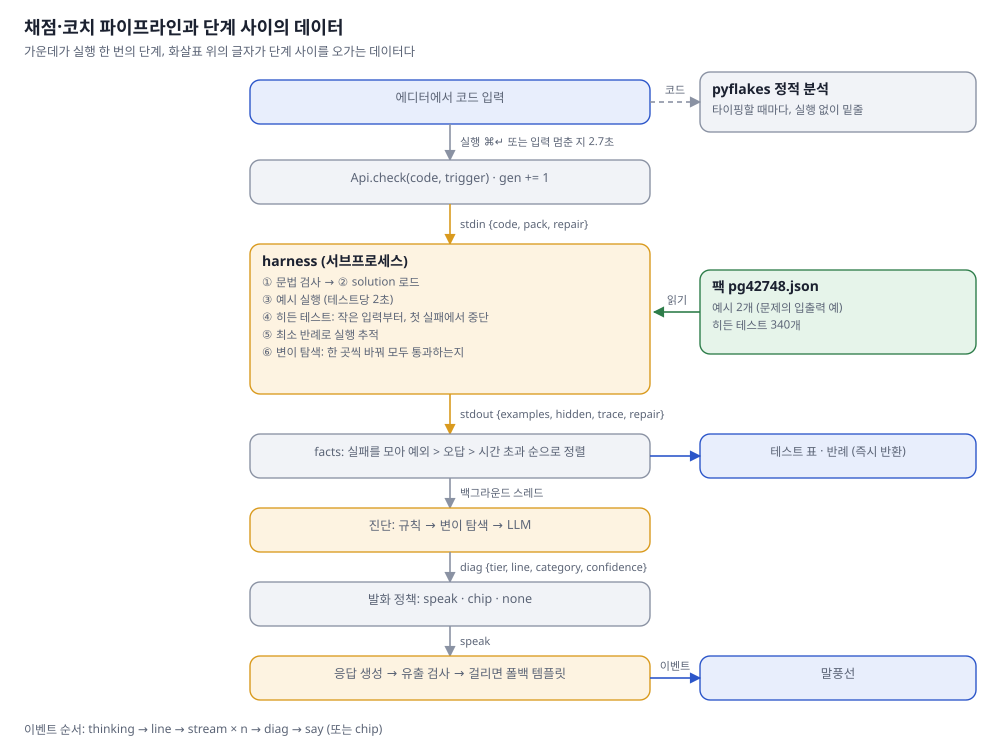
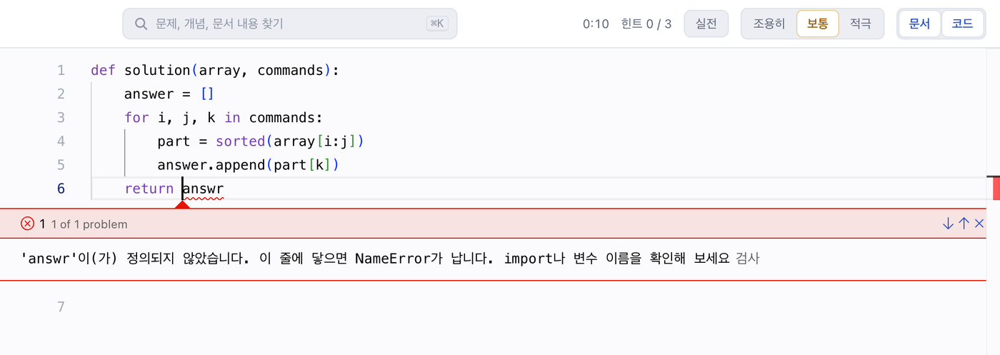
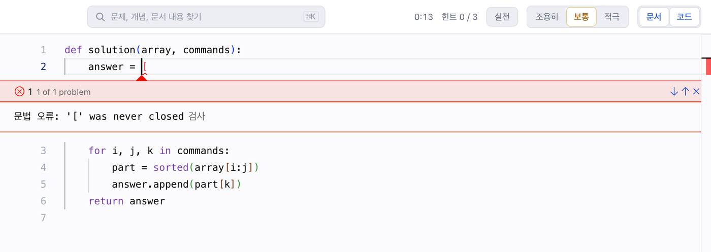
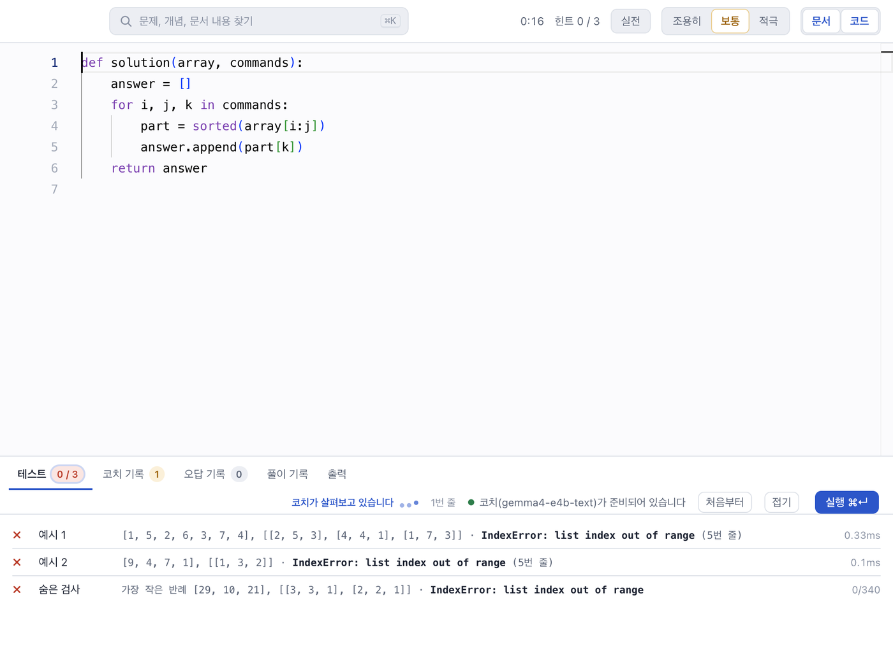
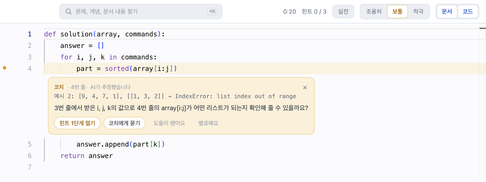
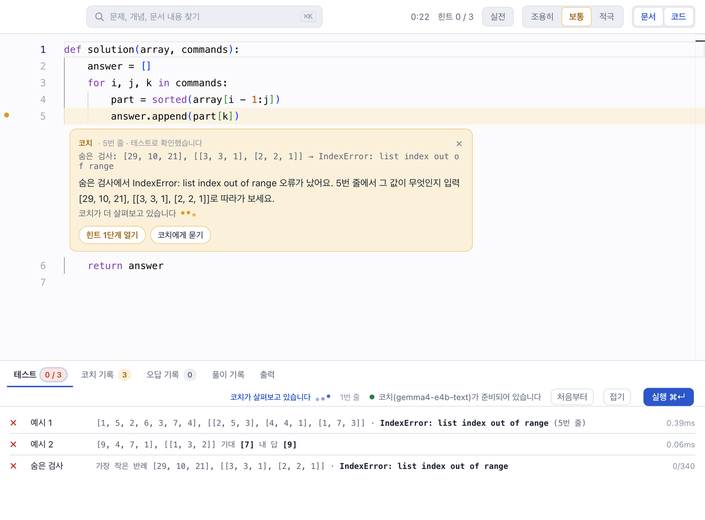
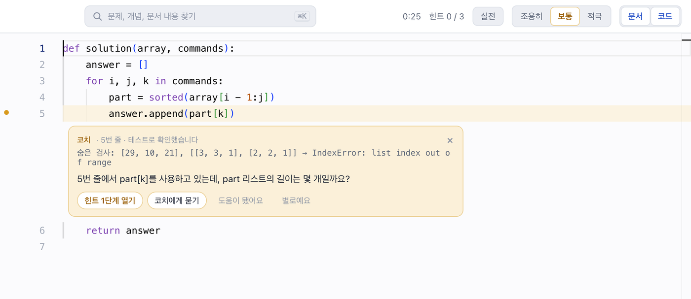
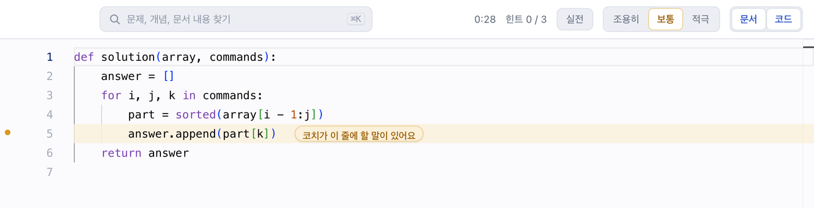
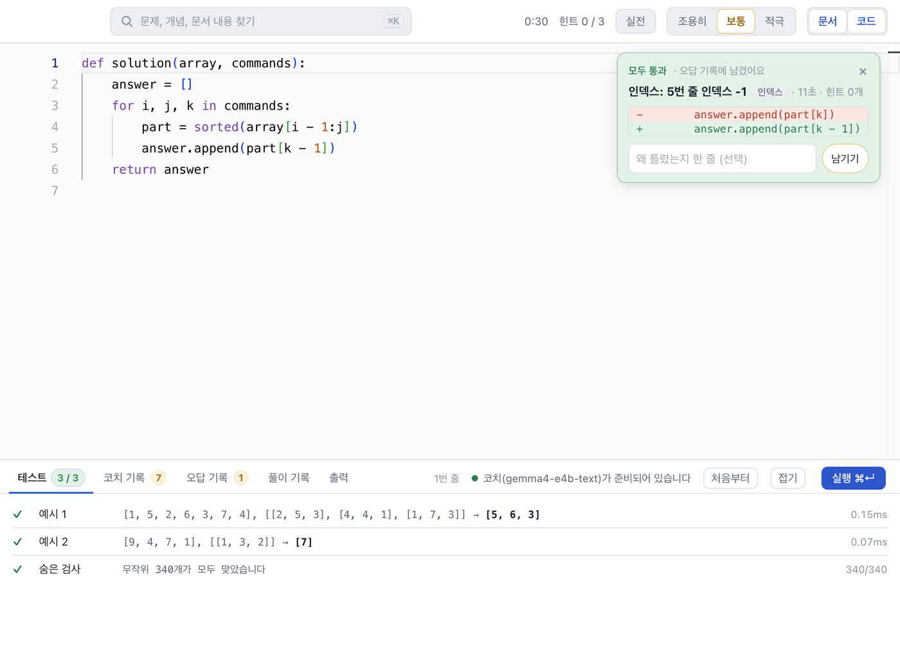
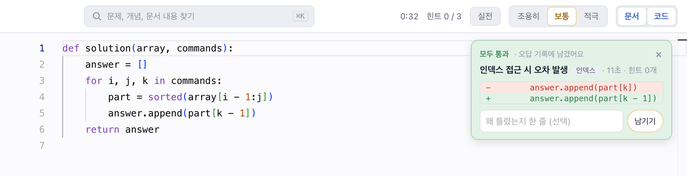

# 예제로 따라가는 채점·코치 파이프라인

[아키텍처 문서](architecture.md)가 구조를 설명한다면, 이 문서는 코드 한 편이 실제로 파이프라인을 지나가며 화면에 무엇을 띄우고, 그동안 뒤에서 어떤 단계가 어떤 데이터를 주고받는지 보여 줍니다. 화면과 데이터는 모두 같은 한 번의 실행에서 나왔습니다. 실제 앱 창을 띄워 실행하는 동안, 같은 프로세스에서 `Api.check`, `runner.check`, `coach`의 진단·발화 함수, `ollama.chat`의 입출력과 프론트엔드로 보낸 이벤트를 시각과 함께 기록했습니다. 측정 환경은 MacBook Air M3, 메모리 16GB, 코치 모델은 gemma4 e4b, 코치 모드는 '보통'이었습니다.

예제 문제는 프로그래머스 'K번째수'입니다. 학생이 흔히 하는 실수인 '1부터 세는 번호를 0부터 센 것'을 넣은 코드로 실행합니다. 1회차는 버그가 두 군데라 LLM 진단까지 가고, 2회차는 한 군데만 남아 변이 탐색이 진단을 확정합니다. 2회차 코드를 고치지 않고 한 번 더 실행해 코치가 말 대신 칩을 붙이는 경우도 보고, 3회차는 통과해서 오답 기록을 남깁니다.

화면마다 붙은 표는 그 화면이 나오기까지 실제로 불린 단계와 보낸 이벤트를 순서대로 적은 것입니다. 시각은 `Api.check`가 불린 순간을 0초로 잡았습니다. harness 안의 단계는 서브프로세스 하나에서 이어서 돌기 때문에 단계별 시각을 따로 재지 않았고, harness 전체 시간을 마지막 단계인 변이 탐색 줄에 적었습니다.

## 파이프라인



실행 한 번은 위에서 아래로 흐릅니다. 프론트엔드가 `Api.check`를 부르면 harness 서브프로세스가 팩을 읽어 채점하고, 결과 JSON을 돌려줍니다. `Api`는 이 결과에서 실패를 정리해 테스트 표를 바로 돌려보내고, 진단과 응답 생성은 백그라운드 스레드에서 이어 갑니다. 코드를 입력하는 동안에는 이와 별도로 pyflakes가 실행 없이 코드를 읽어 밑줄을 긋습니다.

## 예시, 히든 테스트, 숨은 검사

채점에 쓰는 테스트는 두 종류입니다.

- **예시**는 문제 본문의 입출력 예입니다. 학생 화면에 그대로 보이고 가장 먼저 돌립니다.
- **히든 테스트**는 학생에게 보이지 않는 채점용 입출력입니다. 화면과 코치 프롬프트에서는 '숨은 검사'라고 표시하는데, 같은 것입니다.

둘 다 팩 파일에 들어 있습니다. K번째수 팩 `pg42748.json`을 줄이면 이렇습니다.

```json
{
  "params": ["array", "commands"],
  "examples": [
    ["([1, 5, 2, 6, 3, 7, 4], [[2, 5, 3], [4, 4, 1], [1, 7, 3]])", "[5, 6, 3]"],
    ["([9, 4, 7, 1], [[1, 3, 2]])", "[7]"]
  ],
  "hidden": [
    ["([29, 10, 21], [[3, 3, 1], [2, 2, 1]])", "[21, 10]"],
    ["([29], [[1, 1, 1], [1, 1, 1], [1, 1, 1], [1, 1, 1]])", "[29, 29, 29, 29]"],
    ["([76, 88, 18, 36], [[3, 4, 2], [1, 4, 2], [4, 4, 1]])", "[36, 36, 36]"],
    "… 337개 더 (뒤쪽 40개는 원소 90개짜리 배열 같은 큰 입력)"
  ]
}
```

입력과 출력은 `repr` 문자열로 저장하고, harness가 `ast.literal_eval`로 되살립니다. 히든 테스트는 입력이 짧은 순서로 정렬되어 있어서, 첫 실패에서 멈추면 그 입력이 곧 가장 작은 반례가 됩니다.

## 예제 코드

정답은 `array[i - 1:j]`로 자르고 `part[k - 1]`을 꺼내야 합니다. 학생은 두 곳 모두 0부터 세는 습관대로 썼습니다.

| 회차 | 코드 | 남은 버그 |
|---|---|---|
| 1 | `part = sorted(array[i:j])`<br>`answer.append(part[k])` | 4번 줄 슬라이스, 5번 줄 인덱스 |
| 2 | `part = sorted(array[i - 1:j])`<br>`answer.append(part[k])` | 5번 줄 인덱스 |
| 3 | `part = sorted(array[i - 1:j])`<br>`answer.append(part[k - 1])` | 없음 |

1회차 전체 코드는 이렇습니다. 줄 번호는 코치가 짚는 번호와 같습니다.

```python
def solution(array, commands):          # 1
    answer = []                         # 2
    for i, j, k in commands:            # 3
        part = sorted(array[i:j])       # 4
        answer.append(part[k])          # 5
    return answer                       # 6
```

## 0단계: 타이핑 중 코드 검사

실행하기 전에도 에디터는 코드를 검사합니다. 입력이 바뀌면 프론트엔드가 0.4초 기다렸다가 `Api.lint(code)`를 부르고, 백엔드는 pyflakes로 코드를 읽기만 합니다. 실행하지 않으므로 앱 프로세스에서 돌려도 안전합니다.

아래는 6번 줄에 `return answr`로 오타를 낸 화면입니다. 평소에는 밑줄에 마우스를 올리면 메시지가 뜨는데, 이 화면은 Monaco의 '다음 문제로 이동' 명령으로 문제 패널을 열어 같은 메시지를 보이게 했습니다.



이 단계는 `Api.check`를 부르지 않으므로, 표의 시각은 에디터 내용이 바뀐 순간을 0초로 잡았습니다.

| 시각 | 실행된 단계 | 이번 실행의 결과 |
|---|---|---|
| 0초 | 에디터 내용 변경 | `onEdit`이 lint 타이머를 0.4초로 맞춤 |
| 0.41초 | `Api.lint` → pyflakes | 0.9ms 만에 결과 1개 |
| 0.41초 | Monaco 마커 | 6번 줄 12~17열에 빨간 밑줄 |

`Api.lint`가 돌려준 값입니다.

```json
[{"line": 6, "col": 12, "end": 17, "severity": "error",
  "msg": "'answr'이(가) 정의되지 않았습니다. 이 줄에 닿으면 NameError가 납니다. import나 변수 이름을 확인해 보세요"}]
```

괄호를 닫지 않는 문법 오류도 같은 경로로 표시됩니다. 이때 pyflakes는 0.7ms 걸렸습니다.



```json
[{"line": 2, "col": 14, "end": 15, "severity": "error", "msg": "문법 오류: '[' was never closed"}]
```

이 단계는 실행하지 않아도 알 수 있는 실수만 잡습니다. 인덱스가 하나 어긋난 것 같은 논리 오류는 실행해 봐야 드러나므로 harness가 맡습니다. 입력을 멈추면 1.2초 뒤에 코치 프롬프트의 앞부분을 미리 읽히는 `Api.prewarm`이, 2.7초 뒤에 `trigger="idle"`인 자동 검사가 돕니다. 이 예제는 단계를 나눠 보이려고 두 타이머를 끄고 실행(⌘↵)으로만 검사했습니다.

## 1회차: 버그 두 개, LLM 진단까지

### 화면 1-1. 테스트 결과와 '살펴보는 중' (1.0초)



harness는 0.081초 만에 끝나지만, 프론트엔드는 직접 실행일 때 '실행 중' 표시가 눈에 보이도록 최소 0.45초를 기다렸다가 테스트 표를 그립니다. 표에는 예시 두 개의 `IndexError`와 히든 테스트의 가장 작은 반례가 있습니다. 코치는 아직 어느 줄을 짚을지 모르기 때문에 말풍선 대신 상태줄에 '코치가 살펴보고 있습니다'를 띄웁니다.

| 시각 | 실행된 단계 | 이번 실행의 결과 |
|---|---|---|
| 0초 | `Api.check(code, "run")` | `gen`을 1로 올리고 harness를 띄움 |
| | harness: 문법 검사 | 통과 |
| | harness: 예시 | 2개 모두 5번 줄 `IndexError` |
| | harness: 히든 테스트 | 첫 번째 `[29, 10, 21], …`에서 실패해 340개 중 1개만 실행 |
| | harness: 실행 추적 | 실패 입력 중 가장 짧은 예시 2로 4행 |
| 0.081초 | harness: 변이 탐색 | 2곳을 바꿔 봤지만 모든 테스트를 통과하는 수정은 없음 (0.44ms). harness 전체 0.081초 |
| 0.081초 | `coach.facts` | 실패 3개를 정렬, 맨 앞은 예시 2 |
| 0.082초 | `Api.check` 반환 | 수정이 없어 진단을 미루고 `diag: {pending: true}` |
| 0.082초 | 이벤트 `thinking` | `{"gen": 1, "live": true}`. 줄 번호가 없어 상태줄에 표시 |

### 화면 1-2. LLM 진단의 질문 (5.4초)



말풍선이 4번 줄 아래에 붙었습니다. 머리의 'AI가 추정했습니다'는 진단의 `confidence`가 '추정'이라서 붙고, 그 아래 증거 줄은 `diag.fact`에 담긴 예시 2의 입력과 오류입니다. 테스트 표는 화면 1-1과 같습니다.

| 시각 | 실행된 단계 | 이번 실행의 결과 |
|---|---|---|
| 0.083초 | `coach.diagnose` | 백그라운드 스레드. 변이 탐색이 찾은 수정이 없어 LLM 단계로 넘어감 |
| 0.084초 | `ollama.chat` 시작 | 메시지 4개, 504토큰 |
| 1.93초 | 이벤트 `line` | 응답 첫 줄 `줄: 4`를 읽자마자 보냄. 4번 줄 아래에 '살펴보는 중' 말풍선이 뜸 |
| 2.10~3.71초 | 이벤트 `stream` × 38 | `말:` 뒤의 글자를 말풍선에 흘려 씀 |
| 4.06초 | `ollama.chat` 완료 | 첫 토큰 1.67초, 54토큰 생성 |
| 4.07초 | `coach.leak_reason` | 고칠 코드나 값이 없어 통과 (3.5ms) |
| 4.07초 | 이벤트 `diag` | `{"tier": "llm", "category": "인덱스", "line": 4, "confidence": "추정"}` |
| 4.07초 | `Policy.decide` | `speak`. 학생이 직접 실행했고 처음 하는 말 |
| 4.08초 | `coach.say` | 진단 단계에서 이미 만든 문장을 그대로 씀. LLM을 다시 부르지 않음 (0.4ms) |
| 4.08초 | 이벤트 `say` | `{"line": 4, "source": "ai", "message": "3번 줄에서 받은 i, j, k의 값으로 …"}` |

### harness 요청과 응답

`Api.check`는 harness를 띄우고 stdin으로 아래 JSON을 보냅니다. `repair`가 참이면 실패했을 때 실행 추적과 변이 탐색까지 합니다.

```json
{"code": "def solution(array, commands): …", "pack": "…/packs/pg42748.json", "repair": true, "only": null}
```

harness는 채점을 마치고 stdout 마지막 줄에 결과를 씁니다. 1회차의 응답입니다.

```json
{
  "syntax": null,
  "load_error": null,
  "examples": [
    {"args": "[1, 5, 2, 6, 3, 7, 4], [[2, 5, 3], [4, 4, 1], [1, 7, 3]]", "expected": "[5, 6, 3]",
     "ok": false, "ms": 0.33, "error": "IndexError: list index out of range", "line": 5},
    {"args": "[9, 4, 7, 1], [[1, 3, 2]]", "expected": "[7]",
     "ok": false, "ms": 0.1, "error": "IndexError: list index out of range", "line": 5}
  ],
  "hidden": {
    "total": 340, "run": 1, "passed": 0,
    "first_fail": {"args": "[29, 10, 21], [[3, 3, 1], [2, 2, 1]]", "expected": "[21, 10]",
                   "index": 0, "error": "IndexError: list index out of range", "line": 5}
  },
  "trace_args": "[9, 4, 7, 1], [[1, 3, 2]]",
  "trace": [
    {"line": 2, "vars": {"answer": "[]"}},
    {"line": 3, "vars": {"i": "1", "j": "3", "k": "2"}},
    {"line": 4, "vars": {"part": "[4, 7]"}},
    {"line": 5, "vars": {}, "ret": "None"}
  ],
  "repair": {"tried": 2, "sites": 2, "fixes": [], "ms": 0.44}
}
```

이 응답에서 읽을 수 있는 것은 다음과 같습니다.

- 예시 두 개가 모두 5번 줄에서 `IndexError`로 실패했습니다.
- 히든 테스트는 `"run": 1`입니다. 340개 중 첫 번째에서 바로 실패했기 때문에 나머지는 돌리지 않았습니다.
- 실행 추적은 실패한 입력 중 가장 짧은 예시 2로 만들었습니다. `i=1, j=3`이면 1번째부터 3번째인 `[9, 4, 7]`을 잘라야 하는데, `array[1:3]`이 `[4, 7]`만 가져온 것이 4번 줄에서 보입니다. 그다음 `part[2]`가 범위를 벗어나 5번 줄에서 끝납니다.
- 변이 탐색은 바꿀 자리를 두 곳만 찾았습니다. 슬라이스는 변이 대상이 아니라서 `part[k]`의 인덱스 ±1만 해 봤고, 슬라이스 버그가 남아 있으니 어느 쪽도 모든 테스트를 통과하지 못했습니다. 그래서 `fixes`가 비어 있습니다.

### check()의 즉시 반환

변이 탐색이 수정을 찾지 못했으므로 `Api.check`는 진단을 미루고, 채점 결과와 정리한 실패 목록만 0.082초 만에 돌려줍니다. 화면 1-1의 테스트 표가 이 값으로 그려집니다.

```json
{
  "passed": false,
  "facts": [
    {"kind": "error", "where": "예시 2", "args": "[9, 4, 7, 1], [[1, 3, 2]]", "msg": "IndexError: list index out of range", "line": 5},
    {"kind": "error", "where": "숨은 검사", "args": "[29, 10, 21], [[3, 3, 1], [2, 2, 1]]", "msg": "IndexError: …", "line": 5},
    {"kind": "error", "where": "예시 1", "args": "[1, 5, 2, 6, 3, 7, 4], …", "msg": "IndexError: …", "line": 5}
  ],
  "diag": {"pending": true, "fact": {"kind": "error", "where": "예시 2", "…": "…"}}
}
```

실패는 모두 예외라서, 입력이 짧은 순서로 정렬되어 예시 2가 맨 앞에 옵니다. 코치는 이 첫 번째 실패를 다룹니다.

### LLM 진단

백그라운드 스레드가 LLM에 보낸 메시지 네 개입니다. 앞의 세 개는 코드가 바뀌지 않는 한 늘 같아서 프롬프트 캐싱이 됩니다. 이번 실행에서는 문제를 열 때 `coach.warm`이 시스템 프롬프트와 문제 242토큰을 0.90초 동안 미리 읽었습니다. 그때는 코드가 빈 템플릿이었으므로 학생 코드부터 뒤는 이번 호출에서 새로 읽었고, 프롬프트 처리에 1.66초가 걸렸습니다.

````text
[system]
너는 코딩 테스트 연습 코치다. 부드러운 존댓말.
1. 정답 코드나 바꿀 연산자·값을 학생에게 말하지 않는다.
2. 증거에서 출발하고 증거에 없는 버그를 지어내지 않는다.
3. 학생에게 할 말은 반례에서 그 줄의 값을 따라가 보게 하는 질문이다. 두 문장, 100자 안, 코드 블록 없이. 줄은 '12번 줄'처럼 실제 번호로 쓴다.

[user]
[문제]
명령 [i, j, k]마다 array의 i번째부터 j번째까지 잘라 정렬한 뒤 k번째 수를 구한다. 모든 명령의 결과를 배열로 돌려준다. 번호는 1부터 센다.
- array 길이 1~100, 원소 1~100
- commands 길이 1~50

[학생 코드]
  1| def solution(array, commands):
  2|     answer = []
  3|     for i, j, k in commands:
  4|         part = sorted(array[i:j])
  5|         answer.append(part[k])
  6|     return answer

[assistant]
문제와 코드를 읽었습니다.

[user]
[증거] 예시 2에서 실패. 입력: [9, 4, 7, 1], [[1, 3, 2]]
오류: IndexError: list index out of range (5번 줄)
[실행 추적] L번호: 그 줄 실행 뒤 바뀐 변수
L2 answer=[]
L3 i=1 j=3 k=2
L4 part=[4, 7]
L5  ret=None

[할 일]
버그 줄을 찾아 아래 세 줄로만 답한다.
줄: 버그가 있는 줄 번호 (모르면 없음)
말: 학생에게 할 말 (규칙 3)
분류: 비교·경계 / 초기값 / 인덱스 / 자료구조 / 복잡도 / 조건 놓침 / 빈 입력 / 예외 / 기타 중 하나
줄은 오류가 난 줄이 아니라 잘못된 값이 처음 만들어진 줄이다.
````

호출 옵션은 `max_tokens=120`, `temperature=0.3`입니다. 모델이 돌려준 원문은 이렇습니다.

```text
줄: 4
말: 3번 줄에서 받은 i, j, k의 값으로 4번 줄의 array[i:j]가 어떤 리스트가 되는지 확인해 줄 수 있을까요?
분류: 인덱스
```

이번에는 실제 버그 두 곳 중 하나인 4번 줄을 골랐고, 실행 추적에서 `part`가 처음 어긋나는 자리를 정확히 짚었습니다. 하지만 같은 프롬프트로 앞서 기록했을 때는 3번 줄을 골랐습니다. 온도가 0이 아니라서 실행마다 답이 달라질 수 있고, 테스트로 확인한 진단이 아니기 때문에 '추정'으로 표시합니다.

## 2회차: 버그 하나, 변이 탐색이 확정

학생이 4번 줄을 `array[i - 1:j]`로 고쳐 다시 실행합니다.

### 화면 2-1. 정해진 문장이 먼저 (1.0초)



이번에는 변이 탐색이 5번 줄을 확정했으므로 `Api.check`가 반환값에 바로 보일 문장을 담아 보냅니다. 프론트엔드는 이 문장을 5번 줄 말풍선에 띄우고, 아래에 '코치가 더 살펴보고 있습니다'를 붙여 LLM 문장을 기다립니다. 상태줄의 '코치가 살펴보고 있습니다'는 `thinking` 이벤트가 말풍선보다 먼저 도착해서 켜진 것입니다. 테스트 표에서는 예시 2가 예외가 아니라 오답 `[9]`로 바뀌었습니다.

| 시각 | 실행된 단계 | 이번 실행의 결과 |
|---|---|---|
| 0초 | `Api.check(code, "run")` | `gen`을 2로 올리고 harness를 띄움 |
| | harness: 문법 검사 | 통과 |
| | harness: 예시 | 예시 1은 5번 줄 `IndexError`, 예시 2는 기대 `[7]`에 `[9]` |
| | harness: 히든 테스트 | 첫 번째에서 실패해 340개 중 1개만 실행 |
| | harness: 실행 추적 | 예시 2 입력으로 5행 |
| 0.122초 | harness: 변이 탐색 | 5곳 중 5번 줄 `인덱스 -1`이 모든 테스트를 통과 (16.6ms). harness 전체 0.121초 |
| 0.122초 | `coach.facts` | 맨 앞은 숨은 검사의 `IndexError` |
| 0.123초 | `coach.diagnose` | `check()` 안에서 바로 확정. `tier: repair`, 5번 줄, `확인됨` |
| 0.123초 | `Policy.decide` | `speak` |
| 0.124초 | `coach.template` | 폴백 템플릿으로 즉시 보일 문장을 만듦 |
| 0.124초 | 이벤트 `thinking` | 상태줄에 표시 |
| 0.124초 | `Api.check` 반환 | `decision: "speak"`, `instant`에 템플릿 문장 |

### 화면 2-2. LLM이 다듬은 질문 (4.4초)



LLM의 첫 조각이 오면 프론트엔드는 즉시 문장을 지우고 그 자리에 새 문장을 흘려 씁니다. 다 쓰면 `say` 이벤트가 말풍선을 다시 그리고 '코치가 더 살펴보고 있습니다'가 사라집니다. 진단은 여전히 변이 탐색이 확정한 것이라서 머리 표시도 '테스트로 확인했습니다'로 남습니다.

| 시각 | 실행된 단계 | 이번 실행의 결과 |
|---|---|---|
| 0.125초 | `coach.say` | 백그라운드 스레드. 진단이 확정됐으므로 줄 찾기 없이 할 말만 요청 |
| 0.125초 | `ollama.chat` 시작 | 메시지 4개, 495토큰 |
| 1.95~3.11초 | 이벤트 `stream` × 25 | 첫 조각에서 즉시 문장을 지우고 흘려 씀 |
| 3.16초 | `ollama.chat` 완료 | 첫 토큰 1.71초, 28토큰 생성 |
| 3.16초 | `coach.leak_reason` | 백틱을 지운 문장으로 검사해 통과 (0.5ms). 다시 쓰기 없이 첫 시도에 끝남 |
| 3.16초 | 이벤트 `say` | `{"line": 5, "source": "ai", "message": "5번 줄에서 part[k]를 사용하고 있는데, …"}` |

### harness의 응답

```json
{
  "examples": [
    {"args": "[1, 5, 2, 6, 3, 7, 4], …", "expected": "[5, 6, 3]", "ok": false, "error": "IndexError: list index out of range", "line": 5},
    {"args": "[9, 4, 7, 1], [[1, 3, 2]]", "expected": "[7]", "ok": false, "got": "[9]"}
  ],
  "hidden": {"total": 340, "run": 1, "passed": 0,
             "first_fail": {"args": "[29, 10, 21], [[3, 3, 1], [2, 2, 1]]", "expected": "[21, 10]", "error": "IndexError: …", "line": 5}},
  "repair": {
    "tried": 5, "sites": 5, "ms": 16.64,
    "fixes": [{"line": 5, "label": "인덱스 -1", "category": "인덱스", "before": "answer.append(part[k])"}]
  }
}
```

이제 예시 2는 예외가 아니라 오답입니다. 슬라이스는 맞아서 `part`가 `[4, 7, 9]`가 되지만, `part[2]`가 두 번째가 아니라 세 번째 수인 9를 꺼내기 때문입니다.

변이 탐색은 다섯 자리를 찾았습니다. `i - 1`의 `-`를 `+`로 바꾸기, 상수 `1`을 ±1, `part[k]`의 인덱스 ±1입니다. 이 중 `part[k]`를 `part[k - 1]`로 바꾼 변이가 실패했던 입력과 예시, 히든 테스트 앞 120개를 모두 통과했습니다.

### check()의 즉시 반환

변이 탐색이 수정을 찾았으므로 `Api.check`는 진단을 그 자리에서 확정하고, 발화 정책까지 정해서 돌려줍니다. 화면 2-1의 말풍선이 이 값으로 그려집니다.

```json
{
  "passed": false,
  "facts": [
    {"kind": "error", "where": "숨은 검사", "args": "[29, 10, 21], [[3, 3, 1], [2, 2, 1]]", "msg": "IndexError: …", "line": 5},
    {"kind": "error", "where": "예시 1", "args": "[1, 5, 2, 6, 3, 7, 4], …", "msg": "IndexError: …", "line": 5},
    {"kind": "wrong", "where": "예시 2", "args": "[9, 4, 7, 1], [[1, 3, 2]]", "expected": "[7]", "got": "[9]"}
  ],
  "diag": {"tier": "repair", "category": "인덱스", "line": 5, "confidence": "확인됨"},
  "decision": "speak",
  "instant": "숨은 검사에서 IndexError: list index out of range 오류가 났어요. 5번 줄에서 그 값이 무엇인지 입력 [29, 10, 21], [[3, 3, 1], [2, 2, 1]]로 따라가 보세요."
}
```

정렬 규칙에 따라 예외가 오답보다 앞에 오고, 예외 중에서는 입력이 짧은 히든 테스트가 맨 앞입니다.

### 응답 생성

진단이 이미 확정됐으므로 LLM에는 줄을 찾으라고 하지 않고, 그 줄에 대한 질문만 쓰게 합니다. 앞의 세 메시지는 1회차와 같은 구조이고, 마지막 메시지만 다릅니다.

```text
[user]
[증거] 숨은 검사에서 실패. 입력: [29, 10, 21], [[3, 3, 1], [2, 2, 1]]
오류: IndexError: list index out of range (5번 줄)
테스트로 확인한 문제 줄: 5번 줄 `answer.append(part[k])`
실수 분류: 인덱스

[코치가 이미 한 말. 되풀이하지 말 것]
- 3번 줄에서 받은 i, j, k의 값으로 4번 줄의 array[i:j]가 어떤 리스트가 되는지 확인해 줄 수 있을까요?

[할 일]
학생에게 할 말만 쓴다(머리말·따옴표 없이). '테스트로 확인한 문제 줄'을 짚되 무엇을 바꿀지는 말하지 않는다.
```

1회차에서 한 말이 '이미 한 말'로 들어가 같은 질문을 반복하지 않게 합니다. 변이 탐색이 찾은 수정값인 `k - 1`은 프롬프트에 넣지 않습니다. 호출 옵션은 `max_tokens=110`, `temperature=0.5`이고, 모델의 원문은 이렇습니다.

```text
5번 줄에서 `part[k]`를 사용하고 있는데, `part` 리스트의 길이는 몇 개일까요?
```

후처리에서 백틱을 지운 뒤 유출 검사를 거칩니다. 수정값을 말하지 않았으므로 통과하고, `say` 이벤트로 나갑니다. 줄 번호를 미리 알고 있어서 1회차와 달리 `line` 이벤트는 보내지 않습니다.

## 같은 코드로 다시 실행하면: 칩

2회차 코드를 고치지 않고 한 번 더 실행하면 채점과 진단은 똑같이 나옵니다. 그러나 코치는 같은 말을 되풀이하지 않습니다.

### 화면 2-3. 줄 끝의 칩 (2.4초)



말풍선 대신 5번 줄 끝에 '코치가 이 줄에 할 말이 있어요' 칩만 붙습니다. 학생이 칩을 누르면 `Api.explain`이 발화 정책과 상관없이 지금 진단을 다시 말합니다.

| 시각 | 실행된 단계 | 이번 실행의 결과 |
|---|---|---|
| 0초 | `Api.check(code, "run")` | `gen`을 3으로 올리고 harness를 띄움 |
| 0.104초 | harness 전체 | 2회차와 같은 결과. 변이 탐색 8.1ms |
| 0.104초 | `coach.facts` | 2회차와 같음 |
| 0.105초 | `coach.diagnose` | `tier: repair`, 5번 줄, `확인됨` |
| 0.105초 | `Policy.decide` | `chip`. 분류·줄·반례가 같은 말을 2회차에 이미 했음 |
| 0.105초 | 이벤트 `chip`, `Api.check` 반환 | `decision: "chip"`. LLM과 템플릿은 부르지 않음 |

## 3회차: 통과와 오답 기록

5번 줄까지 고쳐서 다시 실행합니다.

### 화면 3-1. 통과 (1.1초)



테스트 표가 3/3으로 바뀌고, 오른쪽 위에 '모두 통과 · 오답 기록에 남겼어요' 말풍선이 뜹니다. 이름은 우선 변이 탐색 결과로 붙인 '인덱스: 5번 줄 인덱스 -1'이고, 아래에 고친 diff가 보입니다. '11초'는 1회차에서 진단이 처음 확정된 때부터 통과까지 걸린 10.5초를 반올림한 값입니다.

| 시각 | 실행된 단계 | 이번 실행의 결과 |
|---|---|---|
| 0초 | `Api.check(code, "run")` | `gen`을 4로 올리고 harness를 띄움 |
| | harness: 예시 | 2개 모두 통과 |
| | harness: 히든 테스트 | 340개 모두 통과 |
| 0.117초 | harness 전체 | 실패가 없어 실행 추적과 변이 탐색은 돌지 않음 |
| 0.118초 | `coach.facts` | 빈 목록이라 통과 |
| 0.12초 | SQLite 기록 | 시도를 통과로 바꾸고, 열려 있던 실패를 오답 기록 1번으로 저장 |
| 0.12초 | `Api.check` 반환 | `passed: true`와 `mistake` |
| 0.12초 | `ollama.chat` 시작 | 백그라운드 스레드에서 오답 이름 짓기 |

harness의 응답에는 실패가 없으므로 `trace`도 `repair`도 없습니다.

```json
{
  "examples": [
    {"args": "[1, 5, 2, 6, 3, 7, 4], …", "expected": "[5, 6, 3]", "ok": true, "got": "[5, 6, 3]"},
    {"args": "[9, 4, 7, 1], [[1, 3, 2]]", "expected": "[7]", "ok": true, "got": "[7]"}
  ],
  "hidden": {"total": 340, "run": 340, "passed": 340, "first_fail": null},
  "repair": null
}
```

'열려 있던 실패'는 1회차에서 진단이 처음 확정될 때 생겼고, 2회차에서 그때의 코드와 변이 탐색 진단으로 갱신됐습니다. 통과하면 `Api.check`가 이 실패를 오답 기록으로 바꿔 함께 돌려줍니다.

```json
{
  "passed": true,
  "mistake": {
    "id": 1,
    "name": "인덱스: 5번 줄 인덱스 -1",
    "category": "인덱스",
    "detected_by": "repair",
    "evidence": "숨은 검사 입력 [29, 10, 21], [[3, 3, 1], [2, 2, 1]] → 기대 [21, 10], 내 답 IndexError: list index out of range",
    "diff": "-        answer.append(part[k])\n+        answer.append(part[k - 1])",
    "time_to_fix": 10.52,
    "hints_at_detection": 0
  }
}
```

### 화면 3-2. LLM이 지은 오답 이름 (2.9초)



백그라운드 스레드가 LLM에 고친 diff를 보여 주고 25자 안의 이름을 지어 달라고 합니다. 이미 통과한 뒤라서 이 프롬프트에는 답을 그대로 넣어도 괜찮습니다. 답이 오면 DB를 고치고 `mistake_named` 이벤트로 말풍선과 오답 노트의 이름을 바꿉니다.

| 시각 | 실행된 단계 | 이번 실행의 결과 |
|---|---|---|
| 0.12초 | `ollama.chat` 시작 | 메시지 2개, JSON 스키마 `{name}`, `max_tokens=60`, `temperature=0.2` |
| 1.64초 | `ollama.chat` 완료 | 1.52초 만에 `{"name": "인덱스 접근 시 오차 발생"}` |
| 1.64초 | 이벤트 `mistake_named` | `{"id": 1, "name": "인덱스 접근 시 오차 발생"}` |

LLM에 보낸 메시지입니다.

```text
[system]
학생이 고친 코드 차이를 보고, 무엇을 틀렸는지 25자 안의 한국어 명사구로 이름을 붙인다. 예: '길이가 같을 때도 답을 바꿈', '방문 표시를 꺼낼 때 함'.

[user]
분류: 인덱스
증거: 숨은 검사 입력 [29, 10, 21], [[3, 3, 1], [2, 2, 1]] → 기대 [21, 10], 내 답 IndexError: list index out of range
고친 차이:
-        answer.append(part[k])
+        answer.append(part[k - 1])
```

## 단계별 정리

| 단계 | 입력 | 출력 | 이번 실행에서 걸린 시간 |
|---|---|---|---|
| pyflakes 검사 | 에디터 코드 | `[{line, col, severity, msg}]` | 0.7~1.3ms |
| harness 채점 | `{code, pack, repair}` | `{examples, hidden, trace, repair}` | 0.08~0.12초 (변이 탐색 포함) |
| 실패 정리 | harness 결과 | 정렬된 `facts` | 0.1ms |
| 변이 탐색 | 실패 입력, 테스트 | `fixes` | 0.44ms (1회차), 16.6ms (2회차), 8.1ms (다시 실행) |
| 변이 탐색 진단 | `fixes` | 확정 진단 | 0.1ms |
| 폴백 템플릿 | 확정 진단 | 즉시 보일 문장 | 0.1ms |
| LLM 진단 | 메시지 4개, 실행 추적 | `줄 / 말 / 분류` | 첫 토큰 1.67초, 완료 3.98초 |
| 응답 생성 | 확정 진단, 이미 한 말 | 질문 한 문장 | 첫 토큰 1.71초, 완료 3.03초 |
| 유출 검사 | 응답 문장 | 통과 또는 사유 | 0.5~3.5ms |
| 오답 이름 짓기 | 고친 diff | 25자 안의 이름 | 1.52초 |

LLM 시간은 모델이 이미 메모리에 올라가 있을 때의 값입니다. 앱을 막 켜서 모델 로드가 겹치면 첫 호출이 그만큼 늦어집니다. 같은 1회차를 그런 상태에서 기록했을 때는 첫 토큰까지 7.8초가 걸렸습니다.
